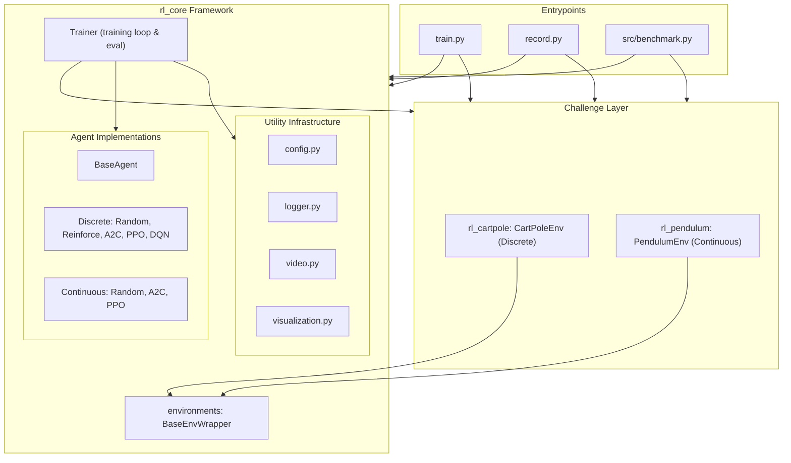
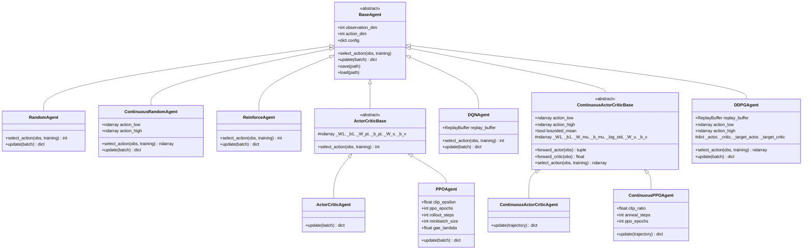
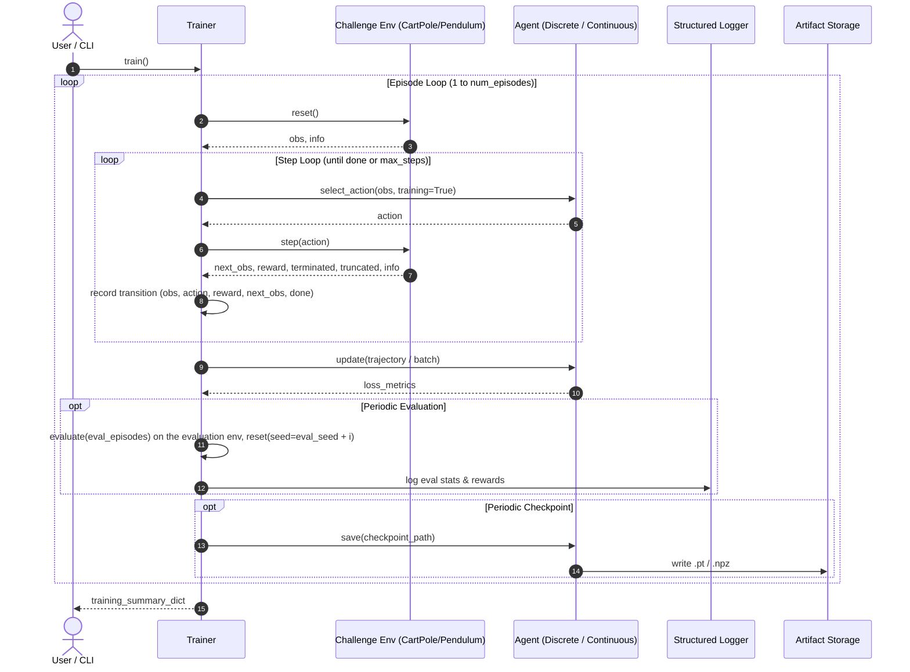

# Architecture Documentation

## Overview

This document describes the decoupled architecture of the reinforcement learning framework, explaining its design
principles, module boundaries, continuous and discrete agent abstractions, challenge packages, and artifact scoping.

```
┌─────────────────────────────────────────────────────────────────────────────┐
│                           src/benchmark.py & CLI                            │
│                         (Multi-Agent Benchmarking)                          │
└───────────────┬─────────────────────────────────────────────┬───────────────┘
                │                                             │
                ↓                                             ↓
┌───────────────────────────────┐             ┌───────────────────────────────┐
│        src/rl_cartpole/       │             │       src/rl_pendulum/        │
│   (Discrete Control Challenge)│             │ (Continuous Control Challenge)│
│  - CartPoleEnv                │             │  - PendulumEnv                │
│  - Noise & Domain Rand        │             │  - Continuous Action Noise    │
│  - CartPoleChallenge          │             │  - PendulumChallenge          │
└───────────────┬───────────────┘             └───────────────┬───────────────┘
                │                                             │
                └──────────────────────┬──────────────────────┘
                                       │
                                       ↓
┌─────────────────────────────────────────────────────────────────────────────┐
│                                 src/rl_core/                                │
│                     (Algorithm-Agnostic Core Framework)                     │
│                                                                             │
│  agents/               training/                 utils/                     │
│  - BaseAgent           - Trainer (loop)          - config.py (YAML/JSON)    │
│  - Discrete Agents     - Checkpoint manager      - logger.py (JSONL)        │
│  - Continuous Agents                             - video.py (MP4 recording) │
│  - ReplayBuffer                                  - visualization.py (plots) │
│                                                                             │
│  challenges/                                                                │
│  - BenchmarkChallenge, CHALLENGES registry, discover_challenges()           │
│                                                                             │
│  environments/                                                              │
│  - BaseEnvWrapper (seeding, observation noise, episode statistics)          │
└─────────────────────────────────────────────────────────────────────────────┘
```

---

## Design Principles

1. **Core Decoupling**: Algorithms and trainers in `rl_core` have zero coupling to specific Gymnasium environments.
2. **Challenge Isolation**: Challenge-specific environments, physics domain randomizations, and configs reside in
   independent packages (`rl_cartpole`, `rl_pendulum`).
3. **Discrete & Continuous Symmetry**: Shared base interfaces support discrete action selection and continuous
   bounded control (Gaussian policies).
4. **Structured Artifact Scoping**: Generated logs, checkpoints, plots, and videos are partitioned deterministically
   by challenge and algorithm: `<artifact_root>/<challenge>/<agent>/`.
5. **Pure NumPy Neural Foundations**: Neural network architectures and gradient optimizations (Adam, He-init,
   clipped PPO, GAE) are implemented natively in NumPy without heavyweight external frameworks. One `Adam` in
   `rl_core/agents/optim.py` serves the continuous agents and, with `optimizer: adam` in the agent config,
   REINFORCE, Actor-Critic, PPO and DQN, which otherwise use plain SGD (DQN's SGD clips each gradient element at
   `grad_clip_value`). DDPG's two-hidden-layer actor and critic use the shared `rl_core/agents/mlp.py`
   (stateless forward and backward passes over named weights), and every continuous agent reads its bounds through
   `rl_core/agents/bounds.py`. Discrete PPO takes the standard form when its
   config sets `rollout_steps`, `minibatch_size` and `gae_lambda`: it buffers whole episodes until it holds
   `rollout_steps` transitions, computes GAE over them (`rl_core/agents/returns.py`, shared with continuous PPO)
   and takes `ppo_epochs` passes of shuffled `minibatch_size` steps. Without those keys it trains on each episode
   alone, full batch, with return-minus-value advantages. The Trainer still calls `update` once per episode; PPO
   returns no metrics on the episodes it only stores. Both PPO agents keep those episodes in one `EpisodeRollout`
   (`rl_core/agents/rollout.py`), which saves them in checkpoints and restores them on load; a rollout still partly
   filled when training ends is not trained on. Each episode ends its GAE trace, and an episode cut by the time limit
   (or by `max_steps_per_episode`) adds γ·V(next state) to its last reward, so CartPole's 500-step limit is not a
   terminal state. Continuous PPO buffers whole episodes the same way with its own `rollout_steps` and
   applies the same rule; both read it from `episode_end` in `rl_core/agents/returns.py`. DQN and DDPG
   store the trainer's `terminated` flag, so they bootstrap through time limits too. The continuous Actor-Critic
   replays each episode in `n_steps` chunks, each with GAE targets bootstrapped from the chunk's next state unless
   the episode truly terminated. Both continuous Gaussian agents can bound their policy mean inside the action
   bounds (`bounded_mean`: bias + scale·tanh(z)); without it the linear mean head can drift past a bound, where every
   executed action is the same.

---

## Component Architecture

The high-level interaction between the training orchestration, environment wrappers, and agent policies is
visualized below:



---

## Agent Class Hierarchy

The agent hierarchy provides clean inheritance across discrete and continuous control paradigms:



---

## Training and Rollout Execution Flow

The sequence diagram illustrates how `Trainer` coordinates episode rollouts, trajectory tracking, gradient updates,
evaluation checkpoints, and video captures. `train.py` and the benchmark give the trainer a separate evaluation
environment (built by the challenge's `make_env`, or `setup_eval_env` in the benchmark) and an evaluation seed from
`rl_core.seeding.eval_seed_for`: evaluation episode i resets that environment with `eval_seed + i`, so every
evaluation in a run plays the same start states and how often a run evaluates does not change its training episodes.
The random agents draw their evaluation actions from a separate generator for the same reason. Without an evaluation
environment (direct `Trainer` callers and tests) evaluation runs on the training environment. `record.py` passes its
playback environment as the evaluation environment with the same seed, so a playback shows the training run's
evaluation start states.



---

## Artifact Directory Scoping

To avoid collisions when multiple agents or challenges are evaluated, artifacts are partitioned into structured
challenge and algorithm subdirectories:

```
checkpoints/
├── cartpole/
│   ├── ppo/
│   │   └── agent_episode_500.pt
│   └── dqn/
└── pendulum/
    ├── ppo/
    │   └── agent_episode_200.pt
    └── actor_critic/

logs/
├── cartpole/
│   └── ppo/
│       ├── rl_cartpole_<timestamp>.log
│       └── metrics_<timestamp>.jsonl
└── pendulum/
    └── ppo/

videos/
├── cartpole/
│   └── ppo/
│       └── cartpole-training-episode-100.mp4
└── pendulum/
    └── ppo/

plots/
├── cartpole/
│   └── ppo/
│       └── training_metrics.png
└── pendulum/
    └── ppo/
```

---

## Extension Guidelines

### Adding a New Challenge

1. Create a new package under `src/rl_<challenge>/`:
   - `environments/<challenge>_env.py`: the challenge's wrapper, a subclass of
     `rl_core.environments.BaseEnvWrapper`. The base already handles seeding (the constructor seed on the first
     reset only), observation noise, episode statistics and `wrap_env`. The subclass validates its own settings,
     calls `_make_env()`, and overrides `_prepare_action` (action noise) and `_apply_domain_randomization`
     (per-episode physics); both default to doing nothing.
   - `environments/make_env.py`: Vectorized and single-environment factory functions.
   - `benchmark.py`: a `BenchmarkChallenge` subclass from `rl_core.challenges`, decorated with `@register_challenge`.
     It implements `make_env(env_config, render_mode)` (usually the package's `make_env_from_config`) and
     `make_agent(agent_type, agent_config, env)` (a lookup in its `AGENT_CLASSES`); the base class builds benchmark
     runs from them. `train.py` and `record.py` pick the challenge whose `name` equals the config's
     `environment.name` exactly (`select_challenge`), or the one `--challenge` names, and build through it, so no
     script needs an edit. Two challenges may share an environment id; the config then needs `--challenge`.
     `discover_challenges()` imports every `src/rl_*/benchmark.py`, so the runner needs no edit; a package that
     fails to import is reported with a warning, in `run_benchmark`'s unknown-challenge error and at the end of
     `src/benchmark.py --help`. A challenge's `__init__` must work with no arguments or with `config_dir` alone (the
     base class provides one), and its `key` must not already be registered.
2. Add reference YAML configurations under `configs/<challenge>_<agent>.yaml`.
3. Add corresponding test suites in `tests/test_<challenge>.py`.

### Adding a New Continuous Algorithm

1. Inherit from `ContinuousActorCriticBase` (or `BaseAgent`) in `src/rl_core/agents/`.
2. Implement `update(trajectory: list[dict[str, Any]]) -> dict[str, float]` with closed-form or autodiff gradients.
3. Expose the agent in `src/rl_core/agents/__init__.py`.
4. Register the agent in the challenge's `AGENT_CLASSES` map.
