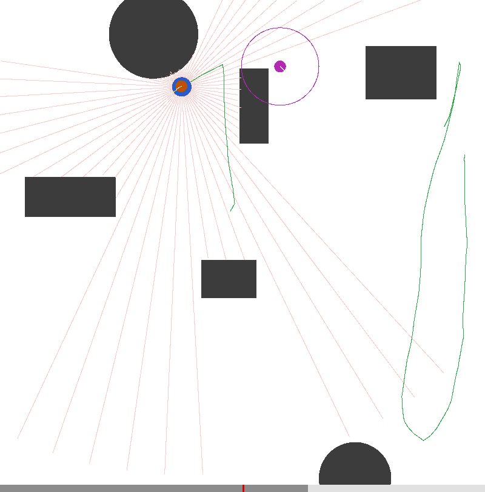

# RL and Robot Navigation

[](
https://github.com/andreijw/AI/actions/workflows/ci.yml)

A pure-NumPy reinforcement-learning framework and a NumPy robot navigation library, built toward a Jetson robot.

**Works:** ten benchmark challenges with agents from REINFORCE to SAC, and localization (EKF and Monte Carlo) in
simulation. **Not yet:** nothing has run on a real robot; SLAM is in progress (landmark EKF-SLAM runs in simulation
and failed 2 of its 9 judged gates), and planning and the hardware are open.

## What's inside

Eight Gymnasium environments and two navigation environments of this project's own, each with a committed config per
agent. Every agent is written in NumPy; only DDPG, TD3 and SAC have an optional PyTorch backend. The table lists
the agents that solve each challenge, measured on seeds 1 to 5 (MountainCar-v0, LunarLander DQN and
LunarLanderContinuous TD3 also on 11 to 15); the full table with every agent, how long each holds its score, and the
caveats is in [docs/results.md](docs/results.md).

| Challenge | Agents and seeds solved ("holds": still at the threshold at the end) | Report |
| :--- | :--- | :--- |
| CartPole-v1 | PPO, DQN and Actor-Critic 5 of 5; REINFORCE 4 of 5 (holds 3) | [report](docs/benchmarks/cartpole_results.md) |
| Pendulum-v1 | SAC, DDPG, TD3 and PPO 5 of 5 (PPO holds 4); continuous Actor-Critic reaches -200 on 2 of 5, holds it on none | [report](docs/benchmarks/pendulum_results.md) (no TD3 or SAC row; see [results](docs/results.md)) |
| Acrobot-v1 | PPO and DQN 5 of 5 (DQN's floor was tuned on seeds 1 to 5, no held-out run) | [results](docs/results.md) |
| MountainCar-v0 | DQN reaches -110 on 10 of 10 seeds but holds it on 3 of 10 | [results](docs/results.md) |
| MountainCarContinuous-v0 | DDPG and TD3 5 of 5 | [results](docs/results.md) |
| LunarLander-v3 | DQN 5 of 5 | [results](docs/results.md) |
| LunarLanderContinuous-v3 | SAC and TD3 5 of 5 | [report](docs/benchmarks/lunarlander_continuous_results.md) (TD3 only; SAC in [results](docs/results.md)) |
| BipedalWalker-v3 | SAC 4 of 5 (holds 1); TD3 2 of 5 (holds 0) | [report](docs/benchmarks/bipedalwalker_results.md) |
| Navigation-v0 | DQN 5 of 5 (threshold: a reward of 7, not a success rate); PPO reaches the threshold on 5 of 5 but holds it on 1 | [report](docs/benchmarks/navigation_results.md) |
| NavigationContinuous-v0 | TD3 5 of 5; PPO reaches it on 5 of 5 but holds it on 0 | [report](docs/benchmarks/navigation_continuous_results.md) |

A run is **solved** when its average training reward over 100 episodes reaches the challenge's threshold, and
**held** when its last 100 episodes still do. The published benchmarks use seeds 1 to 5; `train.py` uses seed
42, so a single run can land on the unlucky side of these numbers.

## Robot navigation

`Navigation-v0` and `NavigationContinuous-v0` put a disc robot in a randomly laid-out room, seeing its range
sensors (five HC-SR04 sonars, or a 64-beam lidar) and told the goal's distance and bearing. The simulator is NumPy
only and `rl_navigation.gym_env` needs neither the training framework nor `rl_core`, so another
project can import it. TD3 reaches the goal in 96% of 100 held-out layouts after 100,000 steps; the random agent in
1%.

`rl_navigation.estimation` finds the robot's pose on a known map from wheel encoders and range readings, with an
extended Kalman filter (EKF) and Monte Carlo localization (MCL, which starts from anywhere and recovers from being
carried elsewhere). In simulation the EKF's position error is a few millimetres while tracking, but it recovers from
a kidnapping in 12 to 28% of runs against MCL's 86 to 98%
([comparison report](docs/benchmarks/localization_results.md)). The video of one trial is written by
`python -m rl_navigation.localization_video`.

`rl_navigation.mapping` builds an occupancy grid from the same scans at known poses: on fresh seeds the lidar map
is 99.96 % accurate with no false occupied cell, while a map built from wheel odometry alone falls to 34 % precision,
which is what SLAM is for.



Details, the API and the measurements are in [docs/navigation.md](docs/navigation.md).

## The robotics ladder

Where this is going, from the roadmap ([docs/roadmap.md](docs/roadmap.md)):

- **Learning in simulation: done.** Classic control, Box2D and navigation challenges, REINFORCE to SAC.
- **Knowing where it is: current.** Odometry, EKF and MCL work in simulation, and so does mapping with known poses;
  landmark EKF-SLAM on a 360-beam lidar runs in simulation, 6.4 cm aligned error on fresh seeds, but
  failed 2 of its 9 judged gates.
- **Planning and driving: planned.** A* and a path follower as a classical baseline for the learned policy.
- **The real robot: planned, nothing run yet.** HC-SR04 and lidar on the Jetson, ROS 2 nodes, fitting the simulated
  noise to real readings. Beyond it, proposed only: MuJoCo robots and arms, GPU-parallel simulation, Isaac Lab,
  multi-agent navigation.

## Quick start

Requirements: Python 3.12. The setup scripts install the three distributions under `packages/` in editable mode
with the dev tools (`requirements-dev.txt`) and the extras: `video` and `onnx` (`rl-core`), `torch` with the gpu
profile, and `box2d` (`rl-challenges`) except on Windows.

```bash
./setup.sh                  # Linux and macOS: .venv with the CPU profile, then the CI checks
./setup.sh --profile gpu    # adds PyTorch (.venv-gpu), for the DDPG, TD3 and SAC backend
```

```powershell
.\setup.ps1                 # Windows: Python 3.12, .venv, dependencies, then the CI checks
```

### LunarLander (Box2D)

LunarLander and BipedalWalker need Box2D, which `./setup.sh` builds (`box2d-py`, from source with `swig`) and
`setup.ps1` does not. By hand, and what happens without it, see
[Installation in docs/usage.md](docs/usage.md#lunarlander-box2d).

### First run

Train PPO on CartPole (about 45 seconds on the project's Jetson, run alone) and watch the average reward
climb to 500:

```bash
python train.py --config configs/cartpole_ppo.yaml
```

It logs a line every 10 episodes, for example `Episode 670 | steps 197377/200000 | Avg Reward (last 10): 500.00 |
Avg Length (last 10): 500.00`, evaluates every 100 episodes and saves a checkpoint under
`checkpoints/cartpole/ppo/`. More: one command per committed config, recording, export, benchmarks and resuming are
in [docs/usage.md](docs/usage.md).

```bash
python benchmark.py --challenge cartpole --agents ppo dqn --episodes 150 --seeds 42       # compare agents
python record.py --config configs/cartpole_ppo.yaml --checkpoint checkpoints/cartpole/ppo/agent_episode_600.pt
pytest -q                                                                                 # the tests
```

## Using the libraries elsewhere

The code is three distributions, released on GitHub (not PyPI) from tags `<dist>-v<version>`
([docs/releasing.md](docs/releasing.md)):

| Distribution | What it is | Needs |
| :--- | :--- | :--- |
| `rl-core` | the framework: agents, trainer, challenge interface, export | Gymnasium, NumPy, PyYAML, Matplotlib |
| `rl-navigation` | the robot's simulator, localization, mapping and SLAM | NumPy only (Gymnasium and `rl-core` as extras) |
| `rl-challenges` | CartPole to BipedalWalker on `rl-core` | `rl-core` |

A robot installs `rl-navigation` alone ([docs/navigation.md](docs/navigation.md#installing-on-the-robot)); another
project, such as a game, trains agents on its own environment by depending on `rl-core` and declaring one entry point
([docs/external-challenges.md](docs/external-challenges.md)).

## Documentation

- [docs/usage.md](docs/usage.md): install, train, record, export, benchmark, configure, develop
- [docs/navigation.md](docs/navigation.md): the navigation simulator and state estimation
- [docs/external-challenges.md](docs/external-challenges.md): training on another project's environment (a game)
- [docs/releasing.md](docs/releasing.md): the distributions' versions, releases and installing them
- [docs/results.md](docs/results.md): which agents solve which challenge, with the caveats
- [docs/agents.md](docs/agents.md): how each agent works
- [docs/roadmap.md](docs/roadmap.md): open work and the robotics ladder
- [docs/pytorch_jetson_timing.md](docs/pytorch_jetson_timing.md): what the Jetson's GPU buys
- [docs/ai-assistants.md](docs/ai-assistants.md): Claude Code setup, MCP servers and skills
- [ARCHITECTURE.md](ARCHITECTURE.md), [TESTING.md](TESTING.md), [CONTRIBUTING.md](CONTRIBUTING.md),
  [CHANGELOG.md](CHANGELOG.md); the folder layout is in [GEMINI.md](GEMINI.md#2-codebase-directory-layout)

## Development

The checks CI runs, from the virtual environment:

```bash
ruff check . && ruff format --check .   # lint and format
mypy                                    # types
pytest -q                               # tests (CI enforces 90% branch coverage)
python scripts/check_doc_links.py       # every Markdown link resolves
```

Read [CONTRIBUTING.md](CONTRIBUTING.md) first: it holds the coding standards and the branch-first, test-driven
workflow (§4). AI assistants also follow [CLAUDE.md](CLAUDE.md) or [GEMINI.md](GEMINI.md). The CI workflows are
synchronized from `.github/workflows` by `scripts/sync_workflow_docs.py`; the `Checks` job fails when the list is
stale:

<!-- WORKFLOWS:START -->

- **ci.yml** - CI
- **codeql.yml** - CodeQL Advanced
- **release.yml** - Release
- **weekly-maintenance.yml** - Weekly Maintenance

<!-- WORKFLOWS:END -->

## License

This project is licensed under the MIT License - see the [LICENSE](LICENSE) file for details.
