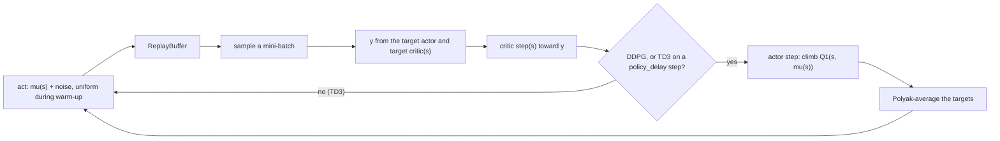

# DDPG and TD3

Learn a deterministic policy for continuous actions from a learned action value. Two agents: `DDPGAgent` and its
subclass `TD3Agent`. Both, and SAC, are built on `rl_core.agents.off_policy.OffPolicyAgent`, which holds the replay
buffer, the warm-up, the update schedule, the critic step, Polyak averaging and the checkpoints. All three can run their
gradient step in PyTorch (`backend: torch`; see [How each agent works](../../agents.md)).

## The idea

DQN picks the best action by taking a max over Q-values, which a continuous action does not allow. Deep Deterministic
Policy Gradient (Lillicrap et al.) learns an **actor** `μ(s)` that outputs one action and a **critic** `Q(s, a)` that
scores it. The critic is trained as DQN's is, by regression onto a bootstrapped target from replayed transitions, with
the target actor's action standing in for the max. The actor climbs the critic: its gradient is `dQ/da` passed back
through `μ`. Exploration is noise added to the actor's action.

DDPG overestimates: the actor finds and exploits peaks where the critic is wrong. Twin Delayed DDPG (Fujimoto et al.)
fixes it three ways: **two critics**, with the smaller of their targets taken; **target-policy smoothing**, clipped
noise on the target action, so a sharp, wrong peak cannot be exploited; and a **delayed actor**, updated, with the
targets, only every `policy_delay` critic steps, once the critics have caught up.



## The update as implemented

**Acting** (`rl_core.agents.off_policy.OffPolicyAgent.select_action`). The first `learning_starts` training actions are
uniform inside the action bounds; after that DDPG and TD3 play `μ(s)` plus noise times `scale`, clipped to the bounds
(`rl_core.agents.ddpg_agent.DDPGAgent._training_action`). The noise is Gaussian, or with `noise_type:
ornstein_uhlenbeck` the temporally correlated process of `rl_core.agents.exploration_noise.OrnsteinUhlenbeckNoise`,
restarted from zero at every episode's end (`rl_core.agents.ddpg_agent.DDPGAgent.end_episode`):

```text
x_{t+1} = x_t - theta * x_t * dt + sigma * sqrt(dt) * eps,     eps ~ N(0, I),  x_0 = 0
```

**When to train** (`rl_core.agents.off_policy.OffPolicyAgent.update`). Each call stores its transitions; once warm-up is
over and the buffer can fill a batch, it takes `updates_per_step` gradient steps per stored transition (at most
`max_updates_per_call`). The actor is

```text
mu(s) = bias + scale * tanh(net(s)),    scale = (high - low) / 2,   bias = (high + low) / 2
```

**A DDPG step** (`rl_core.agents.ddpg_agent.DDPGAgent._train_steps`), in this order:

```text
y      = r + gamma * (1 - terminated) * Q'(s', mu'(s'))          (y held constant)
L_crit = mean( 0.5 * (Q(s, a) - y)^2 )                           (one Adam step on the critic)
L_act  = -mean( Q(s, mu(s)) )                                    (with the critic just stepped, held constant)
target <- tau * online + (1 - tau) * target                      (actor and critic, every step)
```

The target is `rl_core.agents.ddpg_agent.DDPGAgent._bellman_targets` (through
`rl_core.agents.off_policy.OffPolicyAgent._bootstrapped`), the critic loss
`rl_core.agents.off_policy.OffPolicyAgent._critic_loss_and_grads`, the actor loss
`rl_core.agents.ddpg_agent.DDPGAgent._actor_loss_and_grads`, and the averaging
`rl_core.agents.off_policy.OffPolicyAgent._polyak`. The `terminated` flag in the target ([terminated and
truncated](../foundations.md#terminated-and-truncated)) follows the episode-end rule of [Policy
gradients](policy-gradient.md#the-idea).

**A TD3 step** (`rl_core.agents.td3_agent.TD3Agent._train_steps`), with `n` counting gradient steps over the agent's
life:

```text
eps    = clip(N(0, target_policy_noise^2), -target_noise_clip, target_noise_clip)   (in the scaled space, as SB3)
a'     = clip(mu'(s') + scale * eps, low, high)
y      = r + gamma * (1 - terminated) * min(Q1'(s', a'), Q2'(s', a'))               (held constant)
L_Qi   = mean( 0.5 * (Qi(s, a) - y)^2 ),  i = 1, 2                                  (every step)
if n % policy_delay == 0:  L_act = -mean(Q1(s, mu(s))), then Polyak on the actor and both critics' targets
```

The noise is `rl_core.agents.td3_agent.TD3Agent._draw_target_noise`, drawn from its own seed stream, so for the same
seed TD3's actor, first critic, exploration and replay match DDPG's; the minimum is
`rl_core.agents.off_policy.OffPolicyAgent._min_target_q`, and the delay rule
`rl_core.agents.td3_agent.TD3Agent._is_actor_step`. A DDPG agent can load a TD3 checkpoint (actor and first critic); the
reverse is refused.

## Settings that matter

Current values, each with its comment: [`pendulum_ddpg.yaml`](../../../configs/pendulum_ddpg.yaml),
[`pendulum_td3.yaml`](../../../configs/pendulum_td3.yaml),
[`mountaincar_continuous_ddpg.yaml`](../../../configs/mountaincar_continuous_ddpg.yaml),
[`mountaincar_continuous_td3.yaml`](../../../configs/mountaincar_continuous_td3.yaml),
[`lunarlander_continuous_td3.yaml`](../../../configs/lunarlander_continuous_td3.yaml),
[`bipedalwalker_td3.yaml`](../../../configs/bipedalwalker_td3.yaml) and
[`navigation_continuous_td3.yaml`](../../../configs/navigation_continuous_td3.yaml). How each does is in
[results.md](../../results.md).

- `noise_type`, `noise_std`, `ou_theta`, `ou_dt`: the exploration. It has to fit the task (fixes below).
- `hidden_sizes`: rl-zoo's networks are large; in NumPy the committed Pendulum and MountainCarContinuous DDPG configs
  use small ones, and the large ones run on the PyTorch backend.
- `learning_starts`, `buffer_capacity`, `batch_size`: warm-up, memory and mini-batch.
- `tau`: how fast the targets follow.
- `training.update_every` with `updates_per_step`: update during the episode, as SB3's `train_freq` does, or once at its
  end.
- `policy_delay`, `target_policy_noise`, `target_noise_clip` (TD3): SB3's defaults unless a config says otherwise.
- `normalize_observations`: the buffer stores raw observations and normalises each sampled batch.

## Pitfalls

- **Uncorrelated noise on a task that needs a sustained push.** Independent noise at every step averages out; a car that
  must drive one way for many steps never gets there, and the agent learns to stand still.
- **Updating only at the end of each episode.** On long episodes the data for the whole episode comes from one stale
  policy; updating every step, as rl-zoo does, can change the result.
- **Network sizes copied from a GPU library into NumPy.** The same width costs far more on a CPU; time a short run
  first.
- **Reading TD3 as faster.** On an easy task it solves a little later than DDPG, because its actor updates half as
  often; its gain shows on the long tasks.

## Fixes this repo needed

- **rl-zoo's DDPG, smaller.** `pendulum_ddpg.yaml` uses rl-zoo's settings with 64×64 networks, since 400×300 takes about
  16 times longer in NumPy, for 40,000 steps: 5 of 5 seeds solve at 31,000 to 31,600 steps and hold (CHANGELOG.md,
  2026-10-18).
- **Correlated noise.** On MountainCarContinuous, Ornstein-Uhlenbeck noise of sigma 0.5 solved 5 of 5 seeds; Gaussian
  noise of the same 0.5 solved 0 of 5, four seeds learning to stand still (CHANGELOG.md, 2026-10-23).
- **TD3, and an episode-end hook.** TD3 as SB3 implements it; on Pendulum it solved 5 of 5 at 32,600 to 33,400 steps,
  about 1,700 steps after DDPG, since its actor updates half as often. DDPG's noise reset moved from `update` into the
  new `end_episode` hook, called after every training episode, with seeded training byte-identical (CHANGELOG.md,
  2026-10-25).
- **A PyTorch backend for the large networks.** `backend: torch` runs the gradient step in PyTorch, on the Jetson's GPU
  as a CUDA graph, with the same checkpoints; at 400×300 a Pendulum DDPG run took 98 s against 1,074 s in NumPy
  (CHANGELOG.md, 2026-10-25). TD3 followed (CHANGELOG.md, 2026-10-26), and rl-zoo's 400×300 TD3 on MountainCarContinuous
  solved and held on 5 of 5 seeds (CHANGELOG.md, 2026-10-27).
- **Fail before training.** The benchmark now checks that every selected agent's config can be built before any agent
  trains: outside the PyTorch environment it would have trained DDPG for hours, then failed on TD3 (CHANGELOG.md,
  2026-10-27).
- **Update during the episode.** LunarLanderContinuous TD3 updating once per episode held 200 on 3 of 5 seeds
  (CHANGELOG.md, 2026-10-28); with `training.update_every: 1`, as rl-zoo's `train_freq: 1`, it held on 5 of 5, and on
  held-out seeds on 5 against 4 (CHANGELOG.md, 2026-10-30). The committed config adopted it, at 53 to 54 minutes a seed
  alone on the GPU against 28 (CHANGELOG.md, 2026-11-01).
- **One base for the off-policy agents.** `OffPolicyAgent` took what DDPG and TD3 share and SAC needs, as a pure
  refactor checked by golden runs; replay buffers learned to normalise observations at sampling, with no difference on
  Pendulum TD3 (CHANGELOG.md, 2026-11-04).
- **BipedalWalker at half rl-zoo's budget.** At 500,000 steps TD3 reached 300 on 2 of 5 seeds and held it on none,
  behind SAC on every paired seed (CHANGELOG.md, 2026-11-05).
