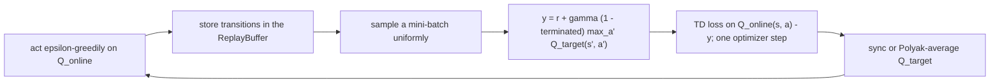

# DQN and its variants

Learn the value of each action from replayed experience, and act greedily on it. One agent, `DQNAgent`, with double DQN
targets, a dueling network, a Huber loss and a decaying learning rate as options. It is the only value-based agent here
and the only off-policy agent for discrete actions.

## The idea

`Q(s, a)` is the discounted return of taking action `a` in state `s` and acting greedily afterwards. It satisfies the
Bellman equation `Q(s, a) = r + γ max_a' Q(s', a')`, so a network can learn it by regression onto that right-hand side,
the **target**, computed from its own estimates. Acting is then just `argmax_a Q(s, a)`, with an occasional random
action (epsilon-greedy) to keep exploring.

Two things keep this regression from chasing its own tail (Mnih et al.): a **replay buffer**, from which mini-batches
are drawn at random, so consecutive, strongly correlated steps are not trained on together; and a **target network**, a
slowly updated copy that computes the targets, so the target does not move with every step of the weights being trained.
Because it learns from stored transitions whatever policy produced them, DQN is **off-policy**, and reuses each
transition many times.



## The update as implemented

Every `update` call (`rl_core.agents.dqn_agent.DQNAgent.update`) stores the new transitions, and once the buffer holds
`min_buffer_size` takes one gradient step, or with `updates_per_step` that many per stored transition, at most
`max_updates_per_call`, each on a fresh mini-batch of `batch_size`. The trainer calls it once per episode, or with
`training.update_every` every that many steps. For each mini-batch:

```text
y = r + gamma * (1 - terminated) * max_a' Q_target(s', a')                      (default)
y = r + gamma * (1 - terminated) * Q_target(s', argmax_a' Q_online(s', a'))     (double_q: true)
e = Q_online(s, a) - y                                                          (y held constant)
L = mean_B( 0.5 * e^2 )                                                         (default)
L = mean_B( h(e) ),  h(e) = 0.5 * e^2 if |e| <= delta else delta * (|e| - 0.5 * delta)   (td_loss: huber)
```

The targets come from `rl_core.agents.dqn_agent.DQNAgent._compute_bellman_targets`, the loss and its hand-written
gradient from `rl_core.agents.dqn_agent.DQNAgent._loss_and_grads`, and the per-sample terms from
`rl_core.agents.dqn_agent._td_loss_terms`, whose Huber slope is `clip(e, -delta, delta)`. The replay buffer stores the
trainer's `terminated` flags ([terminated and truncated](../foundations.md#terminated-and-truncated)), so a time-limit
cut is bootstrapped, by the episode-end rule of [Policy gradients](policy-gradient.md#the-idea).

After each step the target network is either copied whole every `target_update_frequency` gradient steps, or with `tau`
averaged towards the online network after every step (`target ← tau · online + (1 − tau) · target`). The step itself
(`rl_core.agents.dqn_agent.DQNAgent._apply_gradients`) is Adam or SGD at `learning_rate` times the annealing fraction;
plain SGD clips each element of the gradient (`grad_clip_value`), Adam and SGD with `max_grad_norm` clip its global
norm.

**Exploration.** Epsilon follows one of two schedules. With `exploration_steps` it falls linearly from `epsilon_start`
to `epsilon_end` over that many training actions, advanced in `rl_core.agents.dqn_agent.DQNAgent.select_action`;
otherwise it is multiplied by `epsilon_decay` once per `update` call that trained. Evaluation is greedy and leaves
epsilon alone.

**Dueling** (`dueling: true`): a second hidden layer and a one-output head on the observation give a state value, the
first gives advantages, and `Q = V + A − mean_a A`. The network keeps plain DQN's depth with twice its hidden units.

**The network** is `obs → hidden_dim (ReLU) → action_dim`, He-initialised, with a target copy. With
`normalize_observations` the buffer stores raw observations and normalises each sampled batch with the statistics as
they are then, so no stored input goes stale.

## Settings that matter

Current values, each with its comment: [`cartpole_dqn.yaml`](../../../configs/cartpole_dqn.yaml),
[`acrobot_dqn.yaml`](../../../configs/acrobot_dqn.yaml),
[`mountaincar_dqn.yaml`](../../../configs/mountaincar_dqn.yaml),
[`lunarlander_dqn.yaml`](../../../configs/lunarlander_dqn.yaml) and
[`navigation_dqn.yaml`](../../../configs/navigation_dqn.yaml). How each does is in [results.md](../../results.md).

- `exploration_steps` and `epsilon_end`: how long the agent explores, and how much exploration stays. The floor mattered
  in both directions (fixes below).
- `buffer_capacity`: how far back the agent remembers. Too small, and a good policy found mid-run is forgotten.
- `target_update_frequency` or `tau`: counted in gradient steps here, where rl-zoo counts environment steps.
- `updates_per_step` and `max_updates_per_call`: gradient steps per transition.
- `learning_rate`, `optimizer` and `anneal_steps`: the step size and its decay to zero.
- `td_loss: huber` with `huber_delta`: for rewards with rare, large outliers.
- `double_q`, `dueling`: opt-in; neither has won on a committed config.

## Pitfalls

- **A schedule whose unit you have not checked.** A decay "per update" is per what: per episode, per call, per gradient
  step? Walk the real numbers through a run and read the logged `epsilon`.
- **A budget the rule cannot reach.** On CartPole a 100-episode average of 475 alone takes at least 47,500 steps; a
  budget sized for a greedy evaluation after training can be too short to hold (CHANGELOG.md, 2026-10-18).
- **A buffer that forgets.** A small buffer holds only the last few dozen episodes; a policy that has stopped failing
  stops seeing what failure looks like.
- **A squared error dominated by rare large rewards.** One collision penalty far above the typical step reward
  overestimates Q and takes over the gradient.
- **Tiny gaps between action values with a fixed step size.** The greedy action keeps flipping; anneal the rate.
- **Plausible add-ons against a tuned config.** Most lost; compare paired by seed, then confirm on held-out seeds.

## Fixes this repo needed

- **Exploration per action, with a unit you can read.** Until 2026-10-16 `cartpole_dqn.yaml` decayed epsilon by 0.995
  "per update" from 1.0 towards a floor of 0.02, and the agent applied that once per `update` call, which the trainer
  makes once per episode. In the config's first 500-episode budget epsilon ended near 0.08 (0.995 to the 500th power);
  with the 750-episode budget it had from 2026-10-14 it ended at about 0.023, practically the floor. Neither budget was
  the problem: the rule's unit was. "Per update" could mean per call, per episode or per gradient step. The config took
  one gradient step per transition (`updates_per_step: 1.0`), so read as per gradient step the same line reaches the
  floor after ln(0.02) / ln(0.995), about 780 steps: under 40 of CartPole's early, roughly 20-step episodes.
  `exploration_steps`, a linear decay over a stated number of training actions, replaced it, together with
  bootstrapping through time-limit cuts and the shared `optimizer` option (CHANGELOG.md, 2026-10-16).
- **Under the 100-episode rule, a budget that can hold.** At 50,000 steps DQN solved 0 of 5 (CHANGELOG.md, 2026-10-16).
  With Adam, a target sync every 128 gradient steps and epsilon decayed to 0.04 over 8,000 steps, for 300,000 steps, all
  5 seeds solved and held; rl-zoo's 50,000 steps cannot satisfy the rule, since holding a 100-episode average of 475
  alone takes 47,500 steps, and its result is a greedy evaluation after training (CHANGELOG.md, 2026-10-18).
- **Refuse bad settings early.** Invalid `target_update_frequency`, `tau`, buffer sizes and integer settings now fail at
  construction, and warm-up calls report only `epsilon`, so the log averages real updates (CHANGELOG.md, 2026-10-19).
- **No step on a batch it did not store.** A batch without flags or next observations stored nothing yet still took a
  gradient step and decayed epsilon; it now does neither, as in warm-up (CHANGELOG.md, 2026-10-21).
- **The exploration floor, too much.** On Acrobot rl-zoo's floor of 0.1 held on 1 of 5 seeds; 0.02 held on 5 of 5
  (CHANGELOG.md, 2026-10-22). That floor was chosen on the seeds it is reported on, which the README now says
  (CHANGELOG.md, 2026-11-11).
- **The target interval's unit.** rl-zoo counts MountainCar's target interval in environment steps, so its 600 is 300
  gradient steps here; at 600 gradient steps seeds ended at -157 to -165, at 300 at -141 to -148. Huber, two layers and
  scaled inputs were ruled out there (CHANGELOG.md, 2026-10-23).
- **A decaying learning rate.** `anneal_steps` decays the step size linearly to zero; on MountainCar the mean final
  average went from -143 to -133, while n-step returns and Double DQN did no better (CHANGELOG.md, 2026-10-23).
- **A buffer that remembers.** MountainCar's 10,000-transition buffer holds only the last 85 or so episodes; at 100,000
  the final average was better on all 10 seeds (mean -120.5 against -131.2) (CHANGELOG.md, 2026-10-25).
- **The exploration floor, too little.** On LunarLander the 0.1 floor held 200 on 5 of 5 seeds, against 0.02 on 3 of 5
  (CHANGELOG.md, 2026-10-27).
- **Double and dueling, measured.** Neither won on any of CartPole, Acrobot, MountainCar and LunarLander; the committed
  configs barely overestimate, their mean Q within about 4 of the policy's own discounted return (CHANGELOG.md,
  2026-10-29). Raising `max_updates_per_call` on CartPole from 64 to 128 or 256 held on fewer seeds (CHANGELOG.md,
  2026-10-29).
- **Normalised inputs from a replay buffer.** Stored raw and normalised when sampled, as SB3 does; on MountainCar it
  reached -110 on 5 of seeds 1 to 5 against 2 and is committed. Prioritised replay held 200 on LunarLander on 1 of 5
  against 5 of 5, and is not merged (CHANGELOG.md, 2026-11-04).
- **Navigation: Huber and a decaying rate, together.** With squared error and a fixed rate, greedy evaluation reached
  the goal 11% of the time and mostly ran out the 400-step limit (CHANGELOG.md, 2026-11-06). Two stacked causes: a
  collision of -10, about 200 times the step reward's spread, dominated the squared error and overestimated Q, so the
  robot parked; and action gaps of about 0.07 under a fixed rate kept flipping the greedy policy. Huber with
  `anneal_steps` reached the goal 94% of the time; each change alone fell short (CHANGELOG.md, 2026-11-07).
- **A documented limit.** On MountainCar all of seeds 1 to 5 and 11 to 15 reach -110 but only 3 of 10 hold it; the -110
  rule judges a training average with exploration in it, while rl-zoo's figure is a greedy evaluation (CHANGELOG.md,
  2026-11-12).
