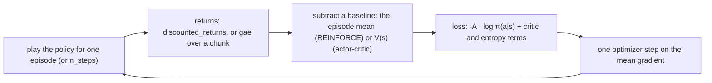

# Policy gradients: REINFORCE and Actor-Critic

Learn a policy directly from the returns it earns, with or without a learned baseline. Three agents share the idea:
`ReinforceAgent` (no critic), `ActorCriticAgent` (discrete actions, a learned baseline) and `ContinuousActorCriticAgent`
(a Gaussian policy for continuous actions, and with `n_steps` a true A2C). PPO builds on the same networks: see
[PPO](ppo.md).

## The idea

A policy network turns an observation into a distribution over actions: a softmax over the discrete actions, or a
Gaussian for a continuous action. Training plays the policy, then raises the log-probability of each action in
proportion to how good the outcome after it turned out to be. That is the policy-gradient theorem (Williams' REINFORCE):
the gradient of the expected return is the expectation of `∇ log π(a|s)` times the return that followed. No model of the
environment and no value of individual actions is needed.

The estimate is unbiased but noisy, since every action is credited with everything that happened after it. A
**baseline** subtracted from the return cuts the noise without biasing the gradient. REINFORCE here uses the episode's
own mean return (and divides by its spread); the actor-critic agents learn a **critic** `V(s)`, the expected return from
a state, and use the **advantage** `G − V(s)`: how much better than expected the outcome was. A critic also allows
**bootstrapping** (prerequisites: [terminated and truncated](../foundations.md#terminated-and-truncated), [returns and
bootstrapping](../foundations.md#returns-and-bootstrapping)): when an episode is cut by a time limit, the critic's
estimate of the state it was cut in stands in for the rewards that were never collected. The rule every agent here
follows: only a true termination (the pole fell, the lander crashed) stops the bootstrap; a cut by the environment's
time limit or the trainer's `max_steps_per_episode` is bootstrapped wherever the agent has a critic to bootstrap from.



## The update as implemented

Every agent here writes its own backward pass in NumPy, checked against finite differences in the tests. The functions
below are where each line is computed.

**Returns.** `rl_core.agents.returns.discounted_returns` computes, from the last step back,

```text
G_t = r_t + gamma * G_{t+1},     G_T = 0      (the episode's last step ends the sum)
```

**REINFORCE**, once per finished episode (`rl_core.agents.reinforce_agent.ReinforceAgent.update`, with the gradient in
`rl_core.agents.reinforce_agent.ReinforceAgent._loss_and_grads`):

```text
Ghat_t = (G_t - mean(G)) / std(G)          (only G_t - mean(G) when std(G) <= 1e-8)
L      = -(1/T) * sum_t Ghat_t * log pi(a_t | s_t)          (Ghat held constant)
```

The policy is `obs → hidden_dim (ReLU) → action_dim → softmax`, sampled while training and played greedily (argmax) in
evaluation. A time-limit cut is not bootstrapped: there is no critic, so the returns simply stop at the last step.

**Actor-Critic, discrete**, once per finished episode (`rl_core.agents.actor_critic_agent.ActorCriticAgent.update` and
`rl_core.agents.actor_critic_agent.ActorCriticAgent._loss_and_grads`). Actor and critic share one ReLU layer
(`rl_core.agents.actor_critic_base.ActorCriticBase`), with a softmax head and a scalar value head:

```text
A_t = G_t - V(s_t)                                  (held constant; not normalised)
L   = (1/T) * sum_t [ -A_t * log pi(a_t|s_t)  +  c_v * 0.5 * (V(s_t) - G_t)^2  -  c_e * H(pi(.|s_t)) ]
H(pi(.|s)) = -sum_a pi(a|s) * log pi(a|s)
```

`c_v` is `value_coef` and `c_e` is `entropy_coef`. With `bootstrap_truncation: true`, a cut episode first gets `gamma *
V(s_T)` added to its last reward, at the true next state `s_T`
(`rl_core.agents.actor_critic_base.ActorCriticBase._bootstrap_cut`), which makes every return `G_t + gamma^(T-t) *
V(s_T)`; a termination is unchanged.

**Actor-Critic, continuous** (`rl_core.agents.continuous_actor_critic.ContinuousActorCriticAgent.update`). A ReLU trunk,
a mean head and a value head, and a log standard deviation that does not depend on the state:

```text
mu(s)    = z(s), or with bounded_mean: bias + scale * tanh(z(s))     (scale, bias from the action bounds)
log N(a | mu, sigma^2) = sum_i -0.5 * ((a_i - mu_i)^2 / sigma_i^2 + 2 log sigma_i + log 2 pi)
H        = sum_i (log sigma_i + 0.5 * log(2 pi e))
L        = -mean(log N(a | mu, sigma^2) * A) + c_v * 0.5 * mean((V - R)^2) - c_e * H
```

The rewards are first multiplied by `reward_scale`. Then one of two schedules:

- `n_steps: 0`: once per episode on Monte Carlo returns, `R = G` (with `bootstrap_truncation`, through
  `rl_core.agents.continuous_actor_critic.ContinuousActorCriticBase._add_bootstrap`), and `A = G − V(s)` normalised over
  the episode unless `normalize_advantages: false`.
- `n_steps: N`: the episode in chunks of N steps, one Adam step per chunk
  (`rl_core.agents.continuous_actor_critic.ContinuousActorCriticAgent._chunk_targets`): `A` from
  `rl_core.agents.returns.gae` with the current critic, bootstrapped from the chunk's next state unless the episode
  truly terminated, and `R = A + V`. With `training.update_every` equal to `n_steps` each chunk is trained on as soon as
  it is collected, which is A2C proper; any other `update_every` is refused.

```text
delta_t = r_t + gamma * V(s_{t+1}) * (1 - done_t) - V(s_t)
A_t     = delta_t + gamma * lambda * (1 - done_t) * A_{t+1}          (rl_core.agents.returns.gae)
```

Training actions are the unclipped Gaussian sample, so the stored action is the one whose log-probability the loss uses;
the environment clips it. Evaluation plays the mean, clipped to the bounds. The optimizer is always Adam with a
global-norm clip (`max_grad_norm`), and after every step the log standard deviation is projected back inside
`rl_core.agents.continuous_actor_critic.LOG_STD_MIN` and `rl_core.agents.continuous_actor_critic.LOG_STD_MAX`.

## Settings that matter

The current values are in the configs, with a comment on each key:
[`cartpole_reinforce.yaml`](../../../configs/cartpole_reinforce.yaml),
[`cartpole_actor_critic.yaml`](../../../configs/cartpole_actor_critic.yaml) and
[`pendulum_actor_critic.yaml`](../../../configs/pendulum_actor_critic.yaml). Which of them solve, and how often, is in
[results.md](../../results.md).

- `optimizer`: plain SGD by default; `adam` is what every committed config uses (below, the first fix).
- `gamma`: the discount. On Pendulum a shorter horizon learns much faster than the usual near-one value.
- `value_coef` and `entropy_coef`: the weights of the critic and entropy terms. The critic term here carries a factor ½,
  where Stable-Baselines3's `vf_coef` multiplies the plain mean squared error, so `value_coef` 0.5 here is SB3's
  `vf_coef` 0.25; the comments were corrected to say so (CHANGELOG.md, 2026-11-11).
- `bootstrap_truncation` (the two actor-critics): bootstrap a time-limit cut instead of treating it as the end.
- `n_steps`, `gae_lambda` and `training.update_every` (continuous): episode updates, replayed chunks, or true A2C.
- `bounded_mean`, `init_log_std`, `reward_scale`, `anneal_steps` (continuous): where the policy starts, the scale the
  critic must fit, and the learning-rate decay.
- `normalize_observations` (every agent here): a running mean and variance of the inputs, frozen in evaluation.
- `training.num_envs`: several environments in lockstep; each finished episode is still its own batch.

## Pitfalls

- **Treating a time-limit cut as the end.** CartPole stops at its time limit while the pole is still up; a return that
  stops there tells the critic the state is worth less than it is. Bootstrap it, as the actor-critics can.
- **Plain SGD with a raw policy gradient.** The gradient's scale changes with the returns and the episode length; Adam
  copes, SGD needed far more episodes or none.
- **A test batch that the policy would never sample.** Replaying a fixed batch many times lets `-A · log π` grow without
  bound for an action the policy has stopped choosing. Sample each batch from the current policy.
- **A quoted boolean.** `"false"` in YAML is a string; the flags are read strictly so it is refused.
- **The training average and the greedy evaluation part ways.** The continuous Actor-Critic on Pendulum plays well
  greedily while its noisy training episodes average far below the threshold; read both before calling a run a failure.

## Fixes this repo needed

### REINFORCE

- **Adam, not SGD.** CartPole REINFORCE with SGD solved 0 of 5 seeds in 2000 episodes, with Adam 5 of 5 (CHANGELOG.md,
  2026-10-15).
- **One returns function, one stable softmax.** Three copies of the discounted return became
  `rl_core.agents.returns.discounted_returns`, with tests that fail without the discount, and the softmax was locked in
  stable at logits of ±1000 (CHANGELOG.md, 2026-10-15); one `rl_core.agents.softmax.stable_softmax` then replaced the
  inline copies (CHANGELOG.md, 2026-10-20).
- **Separate random streams.** Gymnasium's `reset(seed=s)` drew the same numbers as `default_rng(s)`, so an agent seeded
  like its environment shared its random numbers; every agent now draws weights, exploration and shuffling from named
  streams of its seed, and the benchmarks were republished (CHANGELOG.md, 2026-10-19).
- **Say what the baseline is.** The per-episode standardisation is a variance-reduction heuristic and slightly biased,
  since the episode's own mean depends on its actions; the docstrings were corrected to say so (CHANGELOG.md,
  2026-11-11).
- **A cut stays an end.** When the actor-critics learned to bootstrap a cut, REINFORCE, which has no critic to bootstrap
  from, kept treating it as the end, and a test now pins that (CHANGELOG.md, 2026-11-12).
- **Several environments.** With `training.num_envs: 4` on CartPole, REINFORCE solved on 5 of 5 seeds against 4 of 5
  with one; no committed config changed (CHANGELOG.md, 2026-11-09).

### Actor-Critic, discrete

- **Adam, not SGD.** With Adam the CartPole Actor-Critic first reached 475 at episodes 490 to 839, against 906 to 1269
  with SGD (CHANGELOG.md, 2026-10-15).
- **The "overfit collapse" was the test's.** A test replayed one fixed batch of alternating actions 1,000 times; the
  batch kept an action the policy had stopped choosing, with an advantage of about -0.5, so its `-A · log π` term had no
  lower bound, and the policy head and the shared layer grew each other until the SGD critic diverged. No agent code
  changed; the test now samples every batch from the agent's own policy (CHANGELOG.md, 2026-10-29).
- **Its name.** It learns from whole-episode Monte Carlo returns with a learned baseline: REINFORCE with a baseline, not
  A2C, and the docs now say so (CHANGELOG.md, 2026-11-11).
- **Bootstrap the time limit.** With `bootstrap_truncation`, on `cartpole_actor_critic.yaml` and seeds 1 to 5, it held
  475 on 5 of 5 seeds against 4 of 5, the mean final average rose from 481.3 to 495.9, and the mean steps to solve fell
  from 374,332 to 231,271; the committed config turns it on (CHANGELOG.md, 2026-11-12).
- **Several environments.** With four environments it held 475 on 5 seeds against 4 and solved in 272,136 steps against
  374,332, before the bootstrap was adopted; no committed config changed (CHANGELOG.md, 2026-11-09).

### Actor-Critic, continuous

- **A bounded mean and short chunks.** A tanh-bounded policy mean and 8-step chunked updates with GAE made it beat the
  random agent on 5 of 5 seeds in greedy evaluation (-152 ± 45), though its training average ended at -286 to -341 and
  solved no seed (CHANGELOG.md, 2026-10-18).
- **Keep the log standard deviation inside its bounds.** It was only clipped in the forward pass, where the entropy
  bonus could push the hidden raw value past the bound without limit; it is now projected back after every Adam step and
  on load (CHANGELOG.md, 2026-10-21).
- **Strict flags.** `bounded_mean` and `normalize_advantages` were read with `bool(...)`, so a quoted `"false"` switched
  them on; anything but true or false is now refused (CHANGELOG.md, 2026-10-29).
- **True A2C did not close the gap.** Training each 8-step chunk as it is collected, with `update_every: 8`, solved no
  seed either (mean final average -295.0 against -298.5); it stays opt-in (CHANGELOG.md, 2026-10-30).
- **Normalised observations.** `normalize_observations: true` improved the final training average on 5 of 5 seeds (mean
  -282.7 against -298.5) and is committed; 50-step chunks did worse (mean -342.5) (CHANGELOG.md, 2026-11-04).
- **rl-zoo's eight environments.** With `num_envs: 8` and `update_every: 8`, one A2C step over 64 transitions, the mean
  final average rose to -244.1 from -282.7, better on all 5 seeds, and 2 of 5 reached -200 though none held it; the
  greedy evaluation got worse (-184.0 ± 42.7 against -170.0 ± 25.9). The committed config uses it (CHANGELOG.md,
  2026-11-12).
