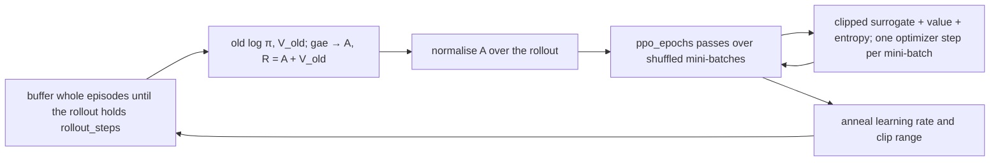

# PPO

Reuse each batch of experience for several careful policy steps, clipped so the policy cannot move too far. Two agents:
`PPOAgent` (discrete actions) and `ContinuousPPOAgent` (a Gaussian policy). They use the actor-critic networks of
[Policy gradients](policy-gradient.md), and add rollouts, generalised advantage estimates and the clipped objective.

## The idea

A plain policy gradient uses each episode once and throws it away, because after one step the data no longer comes from
the current policy. Proximal Policy Optimization (Schulman et al.) reuses a rollout for several passes and corrects for
the drift with the **probability ratio** `r = π(a|s) / π_old(a|s)`, the new policy's probability of the stored action
over the one that collected it. The objective `r · A` would let the policy chase a large advantage too far on stale
data, so PPO **clips** the ratio to `[1 − ε, 1 + ε]` and takes the smaller of the clipped and unclipped terms: once the
policy has moved far enough in the direction the advantage asks for, that sample stops pushing.

Advantages come from **GAE**, an exponentially weighted mix of one-step and many-step estimates (`λ` trades the critic's
bias against the returns' noise), and are normalised over the rollout so one learning rate suits any reward scale.



## The update as implemented

`update` buffers each finished episode in an `rl_core.agents.rollout.EpisodeRollout` and trains once the rollout holds
at least `rollout_steps` transitions (`rl_core.agents.ppo_agent.PPOAgent._train_on_rollout`,
`rl_core.agents.continuous_ppo.ContinuousPPOAgent._train_on_rollout`). Each episode ends its own GAE trace
(`rl_core.agents.returns.episode_end`): a time-limit cut first gets `gamma * V(next state)` added to its last reward
(`rl_core.agents.actor_critic_base.ActorCriticBase._bootstrap_cut`, and in the continuous agent
`rl_core.agents.continuous_actor_critic.ContinuousActorCriticBase._add_bootstrap` after `reward_scale`), by the
episode-end rule of [Policy gradients](policy-gradient.md#the-idea). Then, once per rollout, with the weights as they
are before any step:

```text
log pi_old(a_t|s_t), V_old(s_t)                                 (held constant from here on)
A_t = gae(r, V_old, ends, gamma, lambda),   R_t = A_t + V_old(s_t)
A_t <- A_t - mean(A), then / (std(A) + 1e-8) when the rollout has more than one step
                                                                (continuous: both only then)
f   = anneal_fraction(steps_trained, anneal_steps)              (1 without anneal_steps)
lr  = learning_rate * f,   eps = clip_epsilon * f
```

and for each of `ppo_epochs` passes, over the rollout shuffled into mini-batches, one optimizer step on
(`rl_core.agents.ppo_agent.PPOAgent._minibatch_loss_and_grads`,
`rl_core.agents.continuous_ppo.ContinuousPPOAgent._minibatch_loss_and_grads`):

```text
ratio_t = exp(log pi(a_t|s_t) - log pi_old(a_t|s_t))
L = -mean( min(ratio_t * A_t, clip(ratio_t, 1 - eps, 1 + eps) * A_t) )
    + c_v * 0.5 * mean((V(s_t) - R_t)^2)
    - c_e * H
```

The policy term passes no gradient through a sample whose clipped term is the smaller one. In the discrete agent `H` is
the mean over the mini-batch of each state's softmax entropy; in the continuous one it is the Gaussian's entropy, which
does not depend on the state. The continuous agent also treats a log-ratio beyond a fixed clamp as stale: it is clamped
before the exponential, so it cannot overflow, and that sample gets no policy gradient. `c_v` is `value_coef` and `c_e`
is `entropy_coef`.

The discrete agent steps with SGD or Adam (`optimizer`), the continuous one always with Adam and a global-norm clip.
Shuffling draws from the agent's own seed stream. A checkpoint holds the partly filled rollout and the annealing
counter, so a resumed run continues where it stopped.

## Settings that matter

Current values, each with its comment: [`cartpole_ppo.yaml`](../../../configs/cartpole_ppo.yaml),
[`pendulum_ppo.yaml`](../../../configs/pendulum_ppo.yaml), [`acrobot_ppo.yaml`](../../../configs/acrobot_ppo.yaml),
[`navigation_ppo.yaml`](../../../configs/navigation_ppo.yaml) and
[`navigation_continuous_ppo.yaml`](../../../configs/navigation_continuous_ppo.yaml). How each does is in
[results.md](../../results.md).

- `rollout_steps`: how much experience one update sees. On Pendulum, rollouts spanning many episodes were the difference
  between failing and solving (fixes below).
- `ppo_epochs` with `minibatch_size` (discrete) or `batch_size` (continuous): how hard each rollout is reused.
- `clip_epsilon` (the continuous agent also reads its older name `clip_ratio`): the trust region.
- `gamma` and `gae_lambda`: the horizon, and how far GAE leans on the critic.
- `anneal_steps`: the learning rate and the clip range decay together, linearly, to zero over that many transitions.
- `value_coef` and `entropy_coef`: the critic and entropy weights; how `value_coef` relates to SB3's `vf_coef` is in
  [Policy gradients](policy-gradient.md#settings-that-matter).
- `reward_scale`, `mean_init_scale`, `init_log_std` (continuous): the critic's scale and where the policy starts.
- `normalize_observations`: a running mean and variance of the inputs. It rescued masked CartPole and hurt Pendulum.

## Pitfalls

- **The log-probability of a clipped action.** If the stored action is the clipped one but the policy sampled another,
  its log-probability under a mean far outside the bounds is enormous, and the ratio overflows. Store and score the
  action that was sampled; let the environment clip.
- **A rollout of one episode.** On an environment with short fixed-length episodes, one episode is too little to
  estimate a normalised advantage from.
- **A time limit treated as terminal.** It teaches the critic that the last states of every episode are worth nothing.
- **Inputs whose statistics keep moving while the step size anneals to zero.** With `normalize_observations`, the policy
  late in a run sees inputs normalised differently from those it learned on and cannot follow.
- **An unseeded shuffle.** A mini-batch order drawn from NumPy's global generator makes a seeded run irreproducible.

## Fixes this repo needed

- **A seeded shuffle.** Continuous PPO drew its mini-batch order from NumPy's global generator; it now has its own
  stream, and a source test bans bare `np.random` calls (CHANGELOG.md, 2026-10-13).
- **Standard PPO for discrete actions.** Rollouts across episodes, GAE, shuffled mini-batch epochs and annealing of the
  learning rate and clip range; with rl-zoo's settings plus annealing CartPole solved on 5 of 5 seeds (CHANGELOG.md,
  2026-10-15).
- **Pendulum PPO's five fixes, at once.** The log-probability of the clipped action (the cause of the NaN), an initial
  mean far outside the bounds (now `mean_init_scale`), unscaled rewards (now `reward_scale`), the time limit treated as
  terminal, and γ 0.99 (then 0.9, with learning rate 0.001); continuous PPO also gained `anneal_steps` and the clamp on
  the log-ratio. Under the 10-episode rule then in use, 5 of 5 seeds reached -200 but did not hold it (CHANGELOG.md,
  2026-10-15).
- **Judge by 100 episodes.** Under the 100-episode solve rule, Pendulum PPO at 100,000 steps solved 0 of 5
  (CHANGELOG.md, 2026-10-16).
- **Rollouts across episodes.** Updating on one episode at a time solved 0 of 5; rollouts of 2048 steps over 200,000
  steps solved 5 of 5 and held on 4 of 5, bootstrapping time-limit cuts (CHANGELOG.md, 2026-10-18).
- **Discrete PPO bootstraps the time limit.** CartPole's 500-step cut stopped being terminal, through the rule both PPOs
  now share (`rl_core.agents.returns.episode_end`): the mean steps to solve fell from 108,325 to 79,556, every seed
  faster, holding 5 of 5 (CHANGELOG.md, 2026-10-20).
- **The rollout in the checkpoint.** Buffered episodes are saved, so a resumed run does not lose a partly filled rollout
  (CHANGELOG.md, 2026-10-21).
- **Ideas measured on Pendulum; none was adopted.** Against the committed config (held -200 on 4 of 5 seeds, mean final
  average -186.5): separate actor and critic networks of two 64-unit tanh layers held on 4 of 5 (-183.3); gSDE on the
  shared layer on 4 of 5 (-186.8, one seed worse by 31); gSDE with separate tanh networks, rl-zoo's recipe, on 5 of 5
  (-180.1), but on held-out seeds 11 to 15 on 3 against 4; observation normalisation on 0 of 5 (-544.8) (CHANGELOG.md,
  2026-10-29).
- **Velocity masked: the stack held the information, not its scale.** With the velocities masked, a 4-frame stack solved
  0 of 5 (CHANGELOG.md, 2026-11-01). Velocity survives only as a difference between frames about 50 times smaller than
  the velocity itself; `normalize_observations` solved 4 of 5 and held 2, and with `frame_deltas` too 5 of 5 and held 5
  (CHANGELOG.md, 2026-11-02).
- **Normalisation on Pendulum, measured.** It held -200 on 2 of 5 seeds against 4 for the committed config (mean final
  average -360.7 against -186.5), one seed learning and then sliding to about -1000 (CHANGELOG.md, 2026-11-04).
- **Why, found.** No defect: the stored old log-probabilities match collection to 1e-14. The normaliser's statistics
  kept moving while the learning rate and clip range annealed to zero, so the late policy could not follow its shifting
  inputs; seed 5's late weights scored -1028 greedy with their own statistics and -201 with those of episode 781.
  Freezing the statistics after 100 episodes held on 3 of 5 against 4, so the config stays as it is (CHANGELOG.md,
  2026-11-09).
- **One bootstrap for every critic.** The cut bootstrap moved into the base classes, which both PPOs and both
  actor-critics now share (CHANGELOG.md, 2026-11-12).
