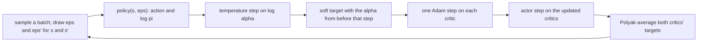

# SAC

Learn a stochastic policy for continuous actions that is rewarded for staying random. One agent, `SACAgent`, written as
Stable-Baselines3 implements Soft Actor-Critic, on the same `rl_core.agents.off_policy.OffPolicyAgent` base as [DDPG and
TD3](ddpg-td3.md), and with a PyTorch backend for large networks.

## The idea

Soft Actor-Critic (Haarnoja et al., with the learned temperature of their follow-up paper) maximises the reward plus `α`
times the policy's entropy. The bonus keeps the policy exploring for as long as exploring pays, and the agent needs no
separate exploration noise: it acts by sampling its own policy.

- The **actor** is a Gaussian squashed by `tanh` into the action bounds. It is trained through a **reparameterised**
  sample, `u = m + σ · ε` with `ε` drawn outside the network, so the gradient of the critic flows into the mean and the
  standard deviation directly, instead of through a likelihood ratio.
- **Twin critics** and the smaller of their targets, as in TD3, keep the value from drifting upward; the target includes
  the next action's entropy bonus, so the critics learn a *soft* value.
- The **temperature** `α` is itself learned: it rises when the policy's entropy falls below a target and falls when it
  is above, so the agent explores a lot early and little once it is confident.



## The update as implemented

The actor is one network with twice the action size as outputs: the mean `m`, then the log standard deviation `l`
(`rl_core.agents.sac_agent.SACAgent._policy`). With `t = tanh(u)` and the log-probability of `t` in `[-1, 1]`:

```text
m, l     = actor(s) split in two;   l = clip(l, LOG_STD_MIN, LOG_STD_MAX)
u        = m + exp(l) * eps,   t = tanh(u),   a = bias + scale * t
log pi   = sum_i ( -eps_i^2 / 2 - l_i - log(2 pi) / 2 )  -  sum_i log(1 - t_i^2)
log(1 - tanh(u)^2) = 2 * (log 2 - u - softplus(-2u))        (exact, finite for every u)
```

The last line is `rl_core.agents.sac_agent.log_one_minus_tanh_squared`; SB3 writes `log(1 - t^2 + 1e-6)` instead. Each
gradient step (`rl_core.agents.sac_agent.SACAgent._train_steps`) draws a mini-batch and two noises, `eps` for `s` and
`eps'` for `s'`, from its own seed stream, then in Stable-Baselines3's order:

```text
alpha    = exp(log_alpha)                                     (this value is used by every line below)
L_alpha  = -log_alpha * mean(log pi(.|s) + target_entropy)    (log pi held constant; with ent_coef: auto)
y        = r + gamma * (1 - terminated) * ( min(Q1'(s', a'), Q2'(s', a')) - alpha * log pi(a'|s') )
                                                              (a' sampled by the online actor at s', held constant)
L_Qi     = mean( 0.5 * (Qi(s, a) - y)^2 ),  i = 1, 2           (one Adam step each)
L_act    = mean( alpha * log pi(a~|s) - min(Q1, Q2)(s, a~) )   (a~ the actor's sample; on the critics just stepped)
then Polyak on both critics' targets (the actor has no target)
```

The temperature loss is `rl_core.agents.sac_agent.SACAgent._ent_coef_loss_and_grads`, the target
`rl_core.agents.sac_agent.SACAgent._soft_targets`, the actor loss and its hand-written gradient
`rl_core.agents.sac_agent.SACAgent._actor_loss_and_grads`. The actor's gradient on the log standard deviation is zero
where it was clipped or sits on a bound, as SB3's clamp gives. With `ent_coef: auto` the agent learns `log α` with its
own Adam; `target_entropy: auto` is minus the action size. Training actions are policy samples after a uniform warm-up;
evaluation and export play the mean, `bias + scale · tanh(m)` (`rl_core.agents.sac_agent.SACAgent._greedy_action`).

Deliberate differences from SB3: the exact form of the tanh correction above; the critics see actions in the
environment's scale rather than SB3's `[-1, 1]`; training starts once the buffer can fill a batch; and gSDE, n-step
returns, learning-rate schedules and a target interval other than every step are left out.

## Settings that matter

Current values, each with its comment: [`pendulum_sac.yaml`](../../../configs/pendulum_sac.yaml),
[`lunarlander_continuous_sac.yaml`](../../../configs/lunarlander_continuous_sac.yaml) and
[`bipedalwalker_sac.yaml`](../../../configs/bipedalwalker_sac.yaml). How each does is in [results.md](../../results.md).

- `ent_coef` (`auto`, `auto_<x>` to learn it from `x`, or a fixed number) and `target_entropy`: the exploration.
- `hidden_sizes`, `learning_rate`, `tau`, `gamma`: the BipedalWalker and LunarLanderContinuous configs follow rl-zoo,
  the Pendulum config uses small networks so that it runs in NumPy.
- `learning_starts` and `buffer_capacity`: the uniform warm-up and the memory.
- `training.update_every` with `updates_per_step`: every step, or in bursts as rl-zoo's `train_freq` does.
- `backend: torch`: the gradient step in PyTorch, on the GPU (see [How each agent works](../../agents.md)).

## Pitfalls

- **`log(1 − tanh²)` computed directly.** Once `tanh` rounds to exactly plus or minus one, the log is `-inf`; use the
  stable form.
- **A time estimate scaled from another agent.** A SAC step runs eight forward and five backward passes, all of them
  every step; an estimate scaled from TD3 at the same width came out far too low. Time a short run before planning a
  sweep.
- **The training average against the greedy evaluation.** SAC's training episodes are samples of a deliberately noisy
  policy; its greedy policy can be far better than its training average says.
- **Saving `log α` with the networks.** It is a trained parameter with its own Adam; a checkpoint without it is another
  agent's, and DDPG and TD3 files are refused.

## Fixes this repo needed

- **SAC in NumPy, checked against autograd.** Written as SB3 implements it, with the stable tanh correction; a float64
  step matched PyTorch's autograd in review, the actor's gradients to 1e-15. On Pendulum, at 64×64 for 40,000 steps,
  every seed solved -200 at 21,800 to 23,200 steps and held, against TD3's 32,600 to 33,400; SB3's 256×256 would take
  about an hour a seed in NumPy and was not measured (CHANGELOG.md, 2026-11-04).
- **The PyTorch backend, clipped where NumPy clips.** `TorchSACAgent` clips each parameter group on the device exactly
  when the NumPy Adam clips it, so the temperature never is; LunarLanderContinuous SAC at rl-zoo's 400×300 reached 200
  on every seed and held it, greedy evaluation 282 ± 5 (CHANGELOG.md, 2026-11-04).
- **BipedalWalker.** Without rl-zoo's gSDE, at 500,000 steps, SAC reached 300 on 4 of 5 seeds and held it on 1, while
  its greedy evaluation was 324.4 ± 1.9, all 5 at 300 or more, ahead of TD3 on every paired seed; a seed took 6,029 s
  with three runs sharing the Jetson (CHANGELOG.md, 2026-11-05).
- **The hold that does not come.** The BipedalWalker training average not holding 300 while every greedy policy scores
  321 to 327 is parked as a limit of the training-average rule, to revisit with gSDE (CHANGELOG.md, 2026-11-12).
- **Gradients at the log-std bounds.** A test pins the PyTorch backend's SAC gradient at the bounds of the log standard
  deviation (CHANGELOG.md, 2026-11-11).
