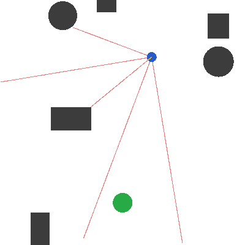
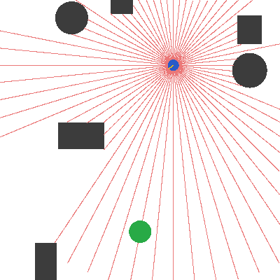
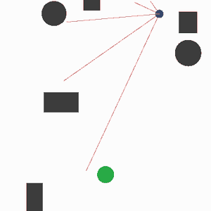
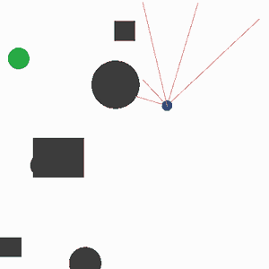
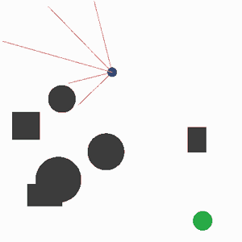
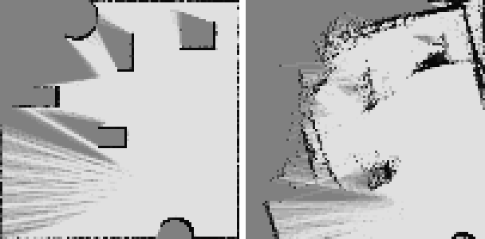

# Navigation-v0 and NavigationContinuous-v0

*Skeleton.* The page names and section headings are fixed so that pages written in parallel can link
to each other; each section is filled in by a later pull request of the docs update.

Drive a disc robot to a goal past obstacles, using its range sensors and the goal's distance and bearing.

## The task

Not written yet.

## Observation, action and reward

Not written yet.

## How an episode ends and the solve threshold

Not written yet.

## Who solves it

Not written yet.

## What was hard

Not written yet.

## See it

The random agent of `configs/navigation_default.yaml`, and the same moment with the config's `sensor` set to `lidar`.
The clip is sped up.

The trained agents, each seed 1 of its committed config, retrained on 2026-11-19 with the same training result as the
reports' seed 1: DQN of `configs/navigation_dqn.yaml` ([Navigation report](../../benchmarks/navigation_results.md))
and TD3 of `configs/navigation_continuous_td3.yaml` ([NavigationContinuous
report](../../benchmarks/navigation_continuous_results.md)). Each final checkpoint plays one greedy episode from the
reset seed in the middle of 20 such episodes (reset seeds 0 to 19): DQN from seed 1 reaches the goal in 85 steps
(return 8.59), TD3 from seed 8 in 83 (return 8.65). DQN reaches the goal in all 20, TD3 in 19, failing from seed 1.
Both clips run at twice the environment's speed (CHANGELOG.md, 2026-11-19).

Mapping with known poses: `rl_navigation.mapping.evaluation.build_map` on the lidar scans of one run of
`rl_navigation.mapping.evaluation.record_run` with seed 101 and 600 steps, the first run that `MAP-1` scores
(TESTING.md `MAP-1`). Dark cells are occupied, light ones free, grey unknown. Mapped from the encoders' dead
reckoning instead, the same scans smear the walls into the free space.

## Try it

Not written yet.
