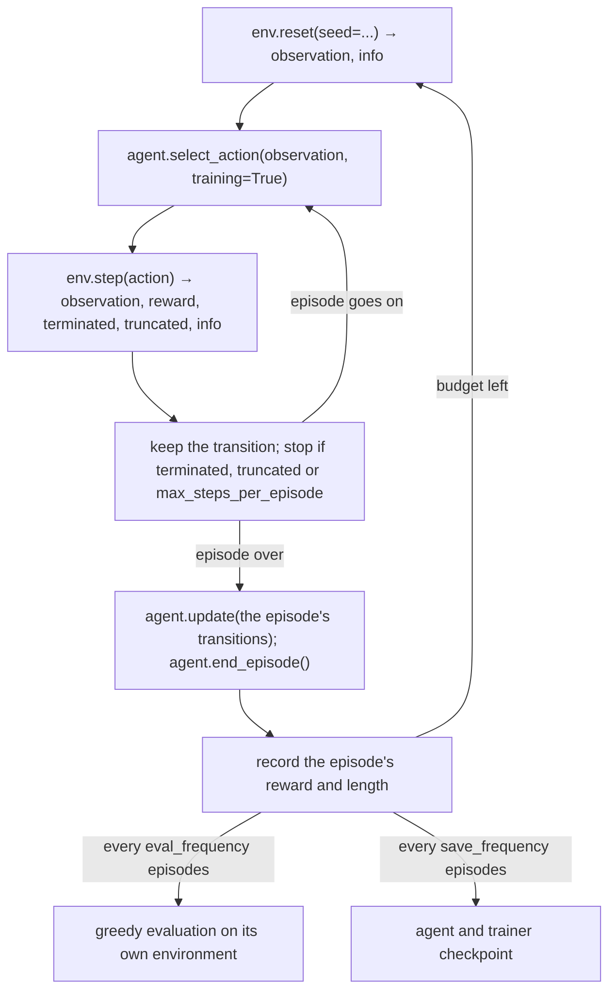

# Foundations

What every agent here shares, taught before any algorithm: how an episode is played and fed to an agent, why an episode
that ends is not always a failure, what a return and a bootstrap are, what "solved" and "held" mean, and the fixes that
changed how every agent is trained or measured. The [learning path](README.md) goes from here to the challenges and
the algorithms.

## The episode loop

Reinforcement learning is a loop between an **agent** and an **environment**. The environment is a
[Gymnasium](https://gymnasium.farama.org/) object, written to the Gymnasium v1 API, which the repository requires
(CHANGELOG.md, 2026-10-19):

- `env.reset(seed=...)` starts an episode and returns `(observation, info)`. Give the seed to the first reset only;
  later resets continue the environment's own random sequence, each with a new start state.
- `env.step(action)` plays one step and returns `(observation, reward, terminated, truncated, info)`. When `terminated`
  or `truncated` is true the episode is over and the environment must be reset.

The agent is a `rl_core.agents.base_agent.BaseAgent`: `select_action(observation, training)` chooses an action,
`update(batch)` learns from the steps it is handed, and `end_episode()` closes an episode. The
`rl_core.training.trainer.Trainer` is the loop that joins the two. `train.py`, `record.py` and the benchmark build an
environment and an agent for a config (through the challenge registry) and hand them to a `Trainer`.



The loop for one episode is `rl_core.training.trainer.Trainer._run_episode`; every step becomes a transition (the
observation, the action, the reward, the next observation and the `done` and `terminated` flags) through
`rl_core.training.trainer._record_step`. By default an agent is updated **once per episode**, with all of the episode's
transitions in one batch (`rl_core.training.trainer.Trainer._update_agent`). An agent that learns from the steps rather
than the episode sets `update_every` in the config, and then gets the episode so far every that many steps. What an
agent does with a batch is the subject of its [algorithm page](README.md#learning-path): REINFORCE and the Actor-Critic
learn from the batch directly, PPO buffers episodes until a rollout is full, and DQN and the other off-policy agents
store the transitions in a replay buffer and learn from samples of it.

A run's length is a budget in the config: `training.total_steps` (environment steps, the finishing episode included) or
`training.num_episodes` when no step budget is set. `max_steps_per_episode` is the trainer's own cut-off, and
`eval_frequency` and `save_frequency` set how often the loop evaluates and checkpoints. With `training.num_envs` above
one, `rl_core.training.trainer.Trainer._train_lockstep` steps several environments together and hands each finished
episode to the agent; the single-environment loop above is what it reproduces with one. Evaluation plays the same
`_run_episode` with `training=False`, so the agent acts greedily, and with its own environment (see [the
fixes](#fixes-that-apply-to-every-agent)).

## Terminated and truncated

`step` returns two flags where older code had one `done`, because an episode can end for two different reasons:

- **Terminated**: the task reached a state it defines as an end, and nothing more can happen from it. The pole fell, the
  lander crashed, the goal was reached. The value of the state after it is zero.
- **Truncated**: something outside the task stopped it, usually a **time limit**. The agent was not in trouble; the
  clock ran out. There is a state after the last one, and it has a value.

CartPole shows the difference. An agent that keeps the pole up is cut at `500` steps by the environment's time limit
(`TimeLimit`), and that episode earned the best score the task allows. Reading that cut as a terminal state tells the
agent that the state it was in leads nowhere, in the very episodes where it did best (CHANGELOG.md, 2026-11-12).
Gymnasium's own migration guide spells out the rule: a termination's next value is zero, a truncation's is the value
function's estimate at the next observation.

The trainer keeps both flags apart. A transition's `done` is `terminated or truncated`, its `terminated` is stored
separately (`rl_core.training.trainer._record_step`), and `max_steps_per_episode` ends an episode as a cut too, with
`terminated` false. Each agent then decides what to do with a cut, and whether it can:

- **PPO and the Actor-Critic** have a critic, so they bootstrap a cut. `rl_core.agents.returns.episode_end` marks where
  an episode's advantage estimate stops and, when the episode was cut, returns the state to bootstrap from; the cut
  episode's last reward then gets `gamma * V(next state)` added
  (`rl_core.agents.actor_critic_base.ActorCriticBase._bootstrap_cut` for the discrete agents,
  `rl_core.agents.continuous_actor_critic.ContinuousActorCriticBase._add_bootstrap` for the continuous Actor-Critic).
  PPO does this always; the Actor-Critic's Monte Carlo returns do it when the agent key `bootstrap_truncation` is on
  ([`cartpole_actor_critic.yaml`](../../configs/cartpole_actor_critic.yaml) turns it on), and the continuous
  Actor-Critic's chunked GAE updates (`n_steps` above zero) always do.
- **DQN and the other off-policy agents** keep the `terminated` flag in the replay buffer, so the target of a cut step
  still bootstraps.
- **REINFORCE** has no critic, so it has nothing to bootstrap with: a cut is an end, and its returns simply stop at the
  last step (CHANGELOG.md, 2026-11-12).

It is also the rule the other way round. If an environment has no real end, as with Pendulum, whose only end is the time
limit, the cut is the only kind of episode end there is ([Pendulum](challenges/pendulum.md)).

## Returns and bootstrapping

An agent is trying to collect reward over the whole episode, not in one step. The **return** from step `t` is the sum of
the rewards from `t` on, each discounted by `gamma` (γ, a number below one) for every step it lies ahead:

```text
G_t = r_t + gamma * r_{t+1} + gamma^2 * r_{t+2} + ...  =  r_t + gamma * G_{t+1}
```

`rl_core.agents.returns.discounted_returns` computes it from the last step back, with the return after the last step
taken as zero. γ says how far ahead the agent looks. With the common `gamma = 0.99` and a reward of `1` every step, as
in CartPole, a state with a long way still to go is worth `1 / (1 - gamma)`, about `100`. A critic `V(s)` is a network
that learns to predict the return from a state, and a one-step target for it reuses the same recursion, with the
critic itself standing in for the tail:

```text
target(s_t) = r_t + gamma * V(s_{t+1})          (bootstrapping: an estimate used to build an estimate)
target(s_t) = r_t                               (the episode terminated at this step: nothing follows)
```

Using the critic like this is called **bootstrapping**. It has less variance than summing a whole episode of noisy
rewards, and it is the only way to learn before the episode ends, at the price of a bias: the estimate being learned is
part of its own target. `rl_core.agents.returns.gae` is the middle path PPO uses, a weighted mix of one-step targets and
whole-episode returns.

Now the time-limit case, with numbers. CartPole under a `500`-step limit, `gamma = 0.99`, reward `1` every step. If the
agent keeps balancing, the true return from the last step of the cut is that step's reward plus about `99` more from the
steps it would have played. The steps actually played add up to far less: from `10` steps before the cut, only about
`9.6`, though the true return is still about `100`:

```text
steps left before the cut      1     2     3    10    100    500
return of the steps actually
played (cut read as an end)   1.0  1.99  2.97  9.56  63.4  99.34
with the bootstrap (V ≈ 100)  ~100  ~100  ~100  ~100  ~100   ~100
```

An agent that reads the cut as an end trains its critic towards the first row, so near the end of a perfect episode it
learns that a balanced pole is worth `1`, where the truth is about `100`. The observation does not tell it how many
steps are left, so that low value spreads to every similar state, and the policy is penalised for exactly the behaviour
that earns the maximum. Adding `gamma * V(next state)` to the last reward restores the second row. On CartPole that was
worth a measured amount: PPO's steps to solve fell once it bootstrapped the cut (CHANGELOG.md, 2026-10-20), and the
Actor-Critic with `bootstrap_truncation` held the threshold on all five seeds against four (CHANGELOG.md, 2026-11-12).
The agent pages ([Policy gradients](algorithms/policy-gradient.md), [PPO](algorithms/ppo.md)) show where each computes
it.

## Solved and held

Every challenge has a `solve_threshold` (`rl_core.challenges.challenge.BenchmarkChallenge.solve_threshold`), the score
Gymnasium or this repository calls the task done; the number for each is on its challenge page and in
[results.md](../results.md#which-agents-solve-which-challenge). Two definitions, as the benchmark computes them
(`classify_run` in [`benchmark.py`](../../benchmark.py)):

- A run **solves** the challenge when its training reward averaged over `100` consecutive episodes first reaches the
  threshold (CHANGELOG.md, 2026-10-16). Only full windows count, so one lucky early episode is not a solve. The solve
  episode is the last episode of that window, and the steps to solve are the training steps up to and including it.
- A run **holds** it when its last `100` episodes still average at or above the threshold. A run can solve and then fall
  back below: that is solving without holding.

The rule asks for a rolling average of the episode rewards the agent earned while training, exploration included. That
is stricter than one good episode and than a greedy evaluation. The benchmark also plays a **greedy evaluation** after
training (ten episodes by default, with the policy's most likely action and no exploration, on its own environment) and
reports it beside the solve rate, since a policy can play well greedily while its training average, which includes
exploration noise, stays below the line. A final evaluation at or above the threshold is recorded
(`eval_reached_threshold`) but is not a solve. A random agent's row in the same report is the floor to read these
against. The numbers a given agent and seed set reach are in the challenge's report under
[`docs/benchmarks/`](../benchmarks/cartpole_results.md), never restated here.

A single `train.py` run uses one seed, which the published reports do not include, so it can land on either side of a
report's solve rate.

## Fixes that apply to every agent

Each of these changed how every agent is trained, measured or saved, and each was found by a result that did not make
sense. The per-agent fixes are on the [algorithm pages](README.md#learning-path).

- **Seeded environments replay one start state** (CHANGELOG.md, 2026-10-13). A seeded environment gave the same start
  state every episode. It now gives a reproducible sequence of different ones, which is what a seed is for: Gymnasium
  uses the seed at the first reset, and later resets continue from it.
- **Budgets in steps, and the 100-episode rule** (CHANGELOG.md, 2026-10-16). Training can be budgeted in environment
  steps (`training.total_steps`) as rl-zoo does, and solving is judged over a 100-episode window, with a run holding
  or not. Before that a shorter average was used, and under the stricter rule results that had counted as solved
  stopped counting (see [CartPole](challenges/cartpole.md) and [Pendulum](challenges/pendulum.md)).
- **rl-zoo's 50,000-step DQN budget cannot satisfy the hold rule** (CHANGELOG.md, 2026-10-18). Holding a 100-episode
  average of 475 on CartPole needs at least 47,500 steps by itself, and rl-zoo's 50,000-step figure is a greedy
  evaluation after training, a different measure. The DQN config therefore trains for more steps than rl-zoo's.
- **Evaluation on its own environment** (CHANGELOG.md, 2026-10-18). Evaluation used to run on the training environment,
  so `eval_frequency` changed what the agent trained on. `Trainer` takes an `eval_env` and an `eval_seed`: episode `i`
  of every evaluation resets it with `eval_seed + i`, so each evaluation plays the same start states and leaves training
  alone (`rl_core.seeding.eval_seed_for`).
- **Separate random streams** (CHANGELOG.md, 2026-10-19). Gymnasium's `reset(seed=s)` draws the same numbers as
  `np.random.default_rng(s)`, so an agent seeded `s` replayed the environment's own random numbers. Each agent and
  replay buffer now draws its weights, exploration, shuffling and sampling from named streams of its seed
  (`rl_core.seeding.derive_rng`). Both benchmarks were republished.
- **Checkpoints keep every generator and the partial PPO rollout** (CHANGELOG.md, 2026-10-21). A checkpoint holds the
  state of each of an agent's random generators, DQN's and DDPG's replay buffer, and the PPO agents' partly filled
  rollout (`rl_core.agents.rollout.EpisodeRollout.checkpoint_state`). With the trainer's own state beside it,
  `train.py --resume` continues a run so that it ends as one that never stopped.
- **A final checkpoint** (CHANGELOG.md, 2026-11-08). The newest checkpoint used to be up to `save_frequency - 1`
  episodes older than the end of training. `Trainer.train` now saves once more at the last episode when `train.py`
  asks for it (`save_final`).
- **Observation settings in checkpoints** (CHANGELOG.md, 2026-11-02). A checkpoint records the environment's
  `frame_stack` and `mask_velocity`, and `rl_core.agents.base_agent.BaseAgent.load` refuses one saved with other values.
  Before, a frame-stack mismatch failed later with a shape error, and a masking mismatch ran on the wrong inputs without
  any error.
- **A checkpoint that does not fit is refused before anything loads** (CHANGELOG.md, 2026-11-11). `load` used to assign
  arrays before checking them, so a checkpoint with another `hidden_dim` could load silently or half-load. It now checks
  every array's presence and shape first, raises a `ValueError` naming the entry, and leaves the agent unchanged.

The common thread is that a number is only as good as what produced it: which start states, which random streams, which
window, which environment. When a result looks too good or too bad, these are the first things to check, before a
hyperparameter.
