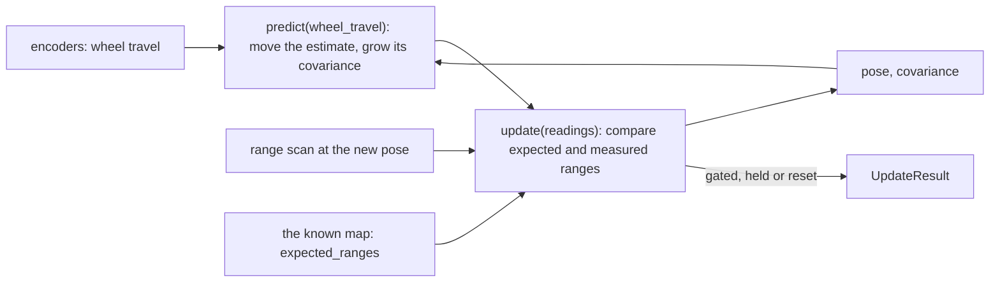

# Estimation: where is the robot?

The wheel encoders of [the previous page](sim-and-sensors.md#odometry) say how far each wheel turned, and slip and noise
make every reading a little wrong. Adding the readings up (dead reckoning) drifts without bound: on the same encoders
as the filter below, 45 of 50 seeded runs are more than 0.5 m off at some step (CHANGELOG.md, 2026-11-06). The range
sensors see the walls and obstacles, whose positions the robot knows from its map, so they can pull the estimate back.
Combining a motion model with such measurements is *state estimation*.

`rl_navigation.estimation` estimates the robot's pose `(x, y, θ)` (metres and radians, in the map's frame) from its
wheel encoders and range readings on a known map. It is a library for the robot's own program: it imports only NumPy
and `rl_navigation.sim`, never Gymnasium or `rl_core` (`tests/test_import_footprint.py`), and nothing in training or the
benchmark calls it. It holds two filters with the same calls:

- an extended Kalman filter, `rl_navigation.estimation.EkfLocalizer`, which tracks a pose it is given at the start;
- a particle filter, `rl_navigation.estimation.MclLocalizer` (Monte Carlo localization), which can also start from
  anywhere and recover from a kidnapping (the robot carried elsewhere without being told), as the EKF cannot, though the
  EKF recovers from a small bump while standing still (below) (CHANGELOG.md, 2026-11-06 to 2026-11-09), and the open
  item "State estimation follow-ups" in [docs/roadmap.md](../../roadmap.md).



## The extended Kalman filter

**Inputs.** The EKF reads the map only through the `rl_navigation.estimation.maps.RangeMap` protocol (`min_range`,
`max_range`, `noise_std`, `expected_ranges(poses)` and `free(points, margin)`), and the particle filter only through
`rl_navigation.estimation.maps.ParticleMap`, which extends it with `num_readings`, `bounds` and `expected_beam_ranges`.
`rl_navigation.estimation.SensorMap(arena, sensor)` provides both for a known `Arena` and a `RangeSensor`. The encoders
are a `rl_navigation.sim.WheelOdometry`, whose placeholder wheel base (0.2 m) and `k` (2.5e-4 m) wait for calibration on
the robot (CHANGELOG.md, 2026-11-06).

**The loop.** Call `predict(wheel_travel)` with each encoder reading, then `update(readings)` with the scan taken at
that pose; `pose` and `covariance` hold the estimate. The update is an iterated EKF (up to 3 guarded Gauss-Newton steps)
in Joseph form, with a finite-difference Jacobian, a linearity check that drops beams across a corner, and a 3σ gate
(CHANGELOG.md, 2026-11-06). A reading at or beyond `max_range`, at or below `min_range`, or NaN counts as a dropout (see
[the sensors](sim-and-sensors.md#range-sensors)). `update` returns an `rl_navigation.estimation.UpdateResult` saying
which beams it used, gated as outliers, or left out as nonlinear (across a corner).

In the simulator, `World` stands in for the robot (run from the repository with the package installed):

```python
import numpy as np

from rl_navigation.estimation import EkfLocalizer, SensorMap
from rl_navigation.sim import LayoutParams, WheelOdometry, World, generate_layout, hc_sr04

rng = np.random.default_rng(0)
layout = generate_layout(rng, LayoutParams())  # on the robot: the known map of its room
sensor, encoders = hc_sr04(), WheelOdometry()  # placeholder noise until calibrated
world = World(layout.arena, sensor, layout.start, layout.goal)  # stands in for the robot
ekf = EkfLocalizer(
    SensorMap(layout.arena, sensor),
    encoders,
    pose=layout.start,
    covariance=np.diag([0.05, 0.05, 0.05]) ** 2,
)
readings, _ = world.read_sensors(rng)
for _ in range(100):
    v, omega = (0.2, 0.0) if readings.min() > 0.4 else (0.0, 1.0)  # drive, or turn away
    motion = world.step(v, omega, rng)
    ekf.predict(encoders.read(motion.v, motion.omega, world.dt, rng))  # (left, right) in metres
    readings, _ = world.read_sensors(rng)  # metres; max_range or NaN when there is no echo
    result = ekf.update(readings)
print(np.round(ekf.pose - world.pose, 3), int(result.used.sum()), "beams used")
```

It prints an error of at most 2 mm and 6 mrad, with 3 of the 5 sonars used in the last update (CHANGELOG.md, 2026-11-06;
the output was rerun for this page). On the robot, the encoder and sonar drivers replace `encoders.read` and
`world.read_sensors`, and the `Arena` is the room's. The filter's model breaks at a collision, where the wheels turn
while the robot stays put, so its estimate drifts from then on.

**How accurate it is.** Measured over 50 seeded layouts × 600 steps of a wandering robot with the filter's defaults
(TESTING.md `EST-1`) (CHANGELOG.md, 2026-11-06): position RMSE 5.7 mm and heading 10.8 mrad with the HC-SR04 sonars, 1.8
mm and 1.7 mrad with a 64-beam lidar; with 30 % of readings dropped, 6.3 mm (sonars) and 2.0 mm (lidar). Dead reckoning
on the same encoders has a position RMSE of 0.93 m, and 45 of its 50 runs exceed 0.5 m of error at some step.

**Is its uncertainty honest?** A filter reports a covariance, and it is only useful if the covariance matches the real
error. The normalised estimation error squared (NEES) tests that: for a pose, 3 degrees of freedom, a consistent filter
averages 3. The filter's mean NEES is 3.2 to 3.3 and its median 2.4 to 2.5; 96 to 97 % of steps lie under 9.35, the
chi-square 97.5 % point, where a consistent filter puts 97.5 %. Occasional spikes remain: the worst step of any run
reaches a NEES of about 340 with the sonars (seed 2) and 2,700 with the lidar (seed 30, a start-up transient from a
first update made 0.04 rad off). In an empty arena the lidar filter's average NEES over 30 runs, 3.05, lies inside the
95 % band [2.19, 3.94], a loose check that catches only a large miscalibration (TESTING.md `EST-1`) (CHANGELOG.md,
2026-11-06).

### When the filter is bumped or lost

A still robot's covariance shrinks to almost nothing, so after a bump of a few centimetres every beam fails the gate.
After `reset_after=3` such scans (`None` disables) the EKF raises its variances to at least `reset_std²` (0.2 m, 0.2 m,
0.1 rad) and recovers (`UpdateResult.reset`). It handles bumps up to about 0.3 m and 0.1 to 0.3 rad with the lidar; the
HC-SR04 sonars recover from position bumps up to 0.3 m and 0.1 rad (CHANGELOG.md, 2026-11-08). Two or more resets in
`EkfLocalizer.recent_resets` (the last 20 scans) mean the filter is lost.

A *held* update keeps its covariance. An update whose iteration does not converge, or whose scan is inconsistent with
the prediction (its NIS above the chi-square 0.999 quantile), is held: the estimate moves but the covariance keeps its
prior instead of shrinking, and the scan counts toward the reset (`UpdateResult.held`; `nis_quantile=None` turns it
off). Without the hold a kidnapped or wrongly matched EKF reset and, on the very next scan, collapsed onto a wrong pose,
with its covariance shrunk from 200 mm to about 2 mm round it; with the hold the lost HC-SR04 run of `EST-3` is gone and
kidnap recovery roughly doubles with the lidar (CHANGELOG.md, 2026-11-09).

A scan with no usable beam counts too when the estimate is not in free space (`RangeMap.free` at margin 0: inside an
obstacle or beyond a wall, where no robot can be). A lost estimate that has left the arena sees no usable beam, and
before this off-map count (`count_off_map=False` turns it off) it reported itself fine while metres off. A reset raises
the covariance and never moves the estimate, so this changes what the filter reports, not where it is (CHANGELOG.md,
2026-11-10).

Two limits are documented. The HC-SR04 does not recover from a 0.3 rad heading bump: three of its four candidate sonars
happen to agree with the wrong heading, so no reset fires (CHANGELOG.md, 2026-11-09, which corrects the earlier
explanation that its beams turn nonlinear). A large heading bump can settle it on a symmetric room's alias (the lidar,
after 1.5 rad in a square room), and once its resets stop nothing signals it, as with MCL (CHANGELOG.md, 2026-11-08).

## Monte Carlo localization

`rl_navigation.estimation.MclLocalizer(range_map, odometry, pose=None, covariance=None, *, rng, settings)` takes the
same `predict(wheel_travel)` and `update(readings)` and exposes `pose`, `covariance`, `particles`, `weights` and
`cluster_weight`. Give it `pose` and `covariance` to start near a known pose, or leave them out to start with the
particles spread over the free space. The idea: keep many guesses of the pose (particles), move each by the encoders,
weight each by how well the ranges it would see match the scan, and resample the heavy ones.

It is augmented MCL (Thrun, Burgard and Fox, *Probabilistic Robotics*, Tables 8.2 and 8.3, with the low-variance
resampler of Table 4.4) with a cut-down beam model: when the likelihood falls against its long-run average, a share of
the particles is redrawn over the free space, which is how it recovers from a kidnapping (CHANGELOG.md, 2026-11-07). One
deviation from Table 8.3: the particles injected on the previous scan are left out of that average, since counted in
they drag it down and keep injecting more for about 1000 scans after the robot is found; what remains after a
disturbance is about 1 % of the particles injected per scan, and a resampling on every scan, until the long-run average
catches up (about 700 scans, 70 s at 10 Hz, after a 10 cm bump with 300 particles) (CHANGELOG.md, 2026-11-07).
`rl_navigation.estimation.MclSettings` (frozen) holds the knobs; the defaults are 2000 particles, 16 beams per scan and
a `model_std` of 0.15 m. At the defaults on one Jetson core a lidar step costs about 45 ms for the filter alone and 50
ms with the simulator, and an HC-SR04 step about 65 ms with the simulator (about 120 ms with `max_beams=64`, every lidar
beam), so size `num_particles` and `max_beams` to the robot's control rate (CHANGELOG.md, 2026-11-07).

`update` returns an `rl_navigation.estimation.MclUpdate`; its `used` marks the beams in the likelihood, so it is not
comparable with the EKF's `UpdateResult.used`. The reported `covariance` is conservative: `model_std` widens the cloud,
and `MclSettings.covariance_scale` corrects it per axis (default `(1, 1, 1)`, unscaled; fitted values per sensor in its
docstring and TESTING.md `EST-2`). Fitted on tuning seeds 1 to 20 they are (0.130, 0.124, 0.308) for the lidar and
(0.174, 0.180, 0.525) for the HC-SR04; a single scalar could not put all four of `EST-2`'s rows in the consistency band
(CHANGELOG.md, 2026-11-08). Known limitation: in a symmetric arena, resampling collapses
one of the mirror-image hypotheses within 1 to 3 scans, so `cluster_weight` ends near 1 and cannot flag the ambiguity
(TESTING.md `EST-2`). Its evaluation (global localization and recovery from a kidnapping at step 300, over fresh seeds
101 to 150) is `EST-2`; `rl_navigation.estimation.evaluation.ekf` and `rl_navigation.estimation.evaluation.mcl` build
either filter for `run_trial(make_localizer=...)`.

## EKF against MCL

`python -m rl_navigation.estimation.comparison` runs both filters on the same seeded trials (each sensor, with its own
dropout and with 30 %) and prints a Markdown report: tracking accuracy and consistency (position and heading RMSE, NEES,
per-axis error against the reported variance), then a global start and a kidnapping at step 300 (shares localized and
recovered, steps to get there, how often a filter is confidently wrong, and how often it is so with a position σ under
5 cm). It saves one record per trial with `--records`, so an interrupted run resumes and jobs run apart merge with
`--from-records`; it writes no file unless `--report` is given. The module is a desk tool and
`rl_navigation.estimation` does not import it (TESTING.md `EST-3`).

Run with the TESTING.md `EST-3` settings (seeds 101 to 150, 600 steps; the report is
[localization_results.md](../../benchmarks/localization_results.md)), the EKF tracks more accurately from the noisy
start (lidar position RMSE about 2 mm against MCL's 7 mm) but recovers from the kidnapping in only 12 to 28 % of runs
against MCL's 86 to 98 %, at about 2.5 to 4.4 ms a step against MCL's 37 to 51 ms; no EKF tracking run is lost since the
hold (2026-11-09; before it the HC-SR04 lost one of 50 at 30 % dropout). Since the off-map count (2026-11-10) a lost EKF
whose estimate has left the arena reports itself lost, and its HC-SR04 share of confidently wrong steps after a
kidnapping fell from 0.35 and 0.34 to 0.16 and 0.19 (CHANGELOG.md, 2026-11-10). The trade is the usual one: a cheap
filter that is precise while it knows where it is, against an expensive one that can find itself again.

## Watching one trial

`python -m rl_navigation.localization_video --seed 101 --mcl-scale 0.130 0.124 0.308 --output <scratch>/seed101.mp4`
writes one seeded lidar trial as a video: the true robot, its scan and path, MCL's particles and estimate from a global
start, and the EKF's estimate from the noisy start, each with its 2σ position ellipse, with a kidnapping at step 300
(`--kidnap-at none` for none). Both filters run on the same trajectory (`rl_navigation.estimation.recording`, painted
with NumPy at 160 pixels per metre). `--stills` saves chosen frames as PNGs; `--output` is required and never
overwritten. The MP4 needs the `video` extra, and the manual test row says what to look for in it (TESTING.md `EST-4`).


*Frame 381 of the seed-101 lidar trial (TESTING.md `EST-4`): the true robot with its lidar scan and path, and a position
estimate drawn with its 2σ ellipse. The kidnapping was at step 300.*

Continue with [Mapping](mapping.md), which uses a pose like this one to build a map of what the sensors see.
