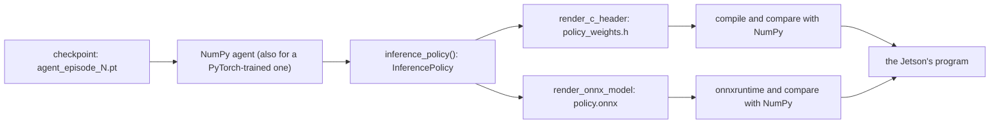

# Export to the robot: how a policy reaches the Jetson

A policy trained here lives in a checkpoint that only this repository's agents can read, and it runs through NumPy or
PyTorch. A robot's computer wants something smaller: a file it can load without the training framework, or a C function
with no Python at all. This last page of the track follows a trained policy, a navigation one in mind, from its
checkpoint to the robot, and says plainly what has been checked and what has not.

## What is exported

Every agent with a network describes its greedy policy as a `rl_core.agents.inference.InferencePolicy`, through
`rl_core.agents.base_agent.BaseAgent.inference_policy`: dense ReLU layers, the observation statistics when it
normalises, and a head (`argmax` for discrete agents, `clip` for a Gaussian mean, or `tanh_scale` for a bounded one and
for DDPG, TD3 and SAC's mean). Dueling DQN is folded into one network whose outputs are its Q-values. A checkpoint
trained on the PyTorch backend exports without PyTorch, through the NumPy agent. The random agents have no network and
are refused (CHANGELOG.md, 2026-11-02; [How each agent
works](../../agents.md#exporting-a-policy-rl_coreagentsinferencepy-rl_coreexport-exportpy)). What is exported is the
*greedy* policy: the action the agent takes when it is not exploring, which is what a robot should do.

## Two formats

**A C header** (`rl_core.export.c_header.render_c_header`) holds the weights as exact float32 hexadecimal literals and
two functions, `policy_outputs` and `policy_act` (an `int` action for a discrete agent, an array for a continuous one),
with the observation normalisation included. It needs only `<math.h>`, so it runs on a microcontroller or inside a ROS
node written in C or C++. **An ONNX model** (`rl_core.export.onnx_model.render_onnx_model`) is the same policy as one
ONNX graph for a device with an ONNX runtime (onnxruntime, TensorRT, OpenVINO): input `observation`, outputs `outputs`
and `action`, the normalisation and action head included, float32 weights, and the agent, checkpoint and observation
settings in its metadata (CHANGELOG.md, 2026-11-02). The commands, the flags and the install of the `onnx` extra are in
[docs/usage.md](../../usage.md#export).

Neither is trusted on faith. `export.py` plays a few greedy episodes with the NumPy agent, runs the exported policy on
every observation of them (the C header compiled with `$CC`, `cc`, `gcc` or `clang`; the ONNX model in onnxruntime), and
compares: to within 1e-5 absolute plus 1e-5 relative, with a discrete action allowed to differ only where NumPy's two
best outputs are that close (a near-tie, reported) (CHANGELOG.md, 2026-11-02). A policy that fails writes no file;
without a compiler or `onnxruntime` it writes unchecked or stops, and says so (`rl_core.export.verify.verify_c_header`,
`rl_core.export.onnx_model.verify_onnx_model`). On this machine's checkpoints of CartPole, Pendulum, LunarLander,
MountainCar and BipedalWalker runs (no navigation checkpoint among them) every export passed with no action mismatch
(TESTING.md `EXP-1` and `EXP-2`).

## What the robot must feed it

An exported file is only the network. The program on the robot has to build the same observation the policy was trained
on and to turn its output into motor commands, and that is where the earlier pages come in. The header and the model
take the observation *after* the environment's `mask_velocity`, `frame_stack` and `frame_deltas`, which they name but do
not apply (CHANGELOG.md, 2026-11-02).

For the navigation policies the observation is the goal's distance, the cosine and sine of its bearing, the last
executed forward speed and turn rate, then the range readings, from five HC-SR04 sonars or a lidar (see [the challenge
page](../challenges/navigation.md#observation-action-and-reward)). In the simulation the goal's distance and bearing are
an oracle. On a robot nothing hands them over: they come from the pose estimate of [estimation](estimation.md) and the
goal's position in the map. A policy trained on perfect poses is therefore only as good as the estimator that replaces
them, and the planner comparison made the same simplification (every planner row uses the true pose; [Planning and
control](planning.md#planner-against-trained-policies)).

The output is an action. For `NavigationContinuous-v0` it is two numbers in [-1, 1] (CHANGELOG.md, 2026-11-05): the
forward speed is `v_max (a0 + 1) / 2` and the turn rate `omega_max a1`, so the robot's driver multiplies by its own
limits (`rl_navigation.planning.continuous_action` is the exact inverse, used by the planner). For `Navigation-v0` it is
one of five rows of `rl_navigation.gym_env.DISCRETE_ACTIONS`, each a fraction of the top speed and of the top turn rate.
The sensor readings must follow the simulator's contract ([the sensors](sim-and-sensors.md#range-sensors)): metres from
each mount, `max_range` when there is no echo.

## Installing the libraries on the robot

The estimators, the mapper and the planner are in the `rl-navigation` distribution, which needs NumPy alone. How a `ROS
2` node installs it is in [docs/navigation.md](../../navigation.md#installing-on-the-robot). The exported policy needs
nothing of the repository at all.

## What has not been done

No policy or planner of this repository has driven a real robot yet. The sensor noise, the dropout and the encoder
parameters in the simulator are placeholders until they are calibrated on the robot, and the sim-to-real step, a report
of what transferred and what did not, is the open item "Hardware and `ROS 2`" in [docs/roadmap.md](../../roadmap.md):
the HC-SR04 and a lidar on the Jetson, a wheeled base, and `ROS 2` nodes for the sensor, the estimator, the mapper, the
planner and the policy over this plain-Python core. Training in a faster simulator and deploying through ONNX is a
proposed item there too. Until then, read the exported file as a checked copy of the simulated policy, not as evidence
that it works on a robot.
