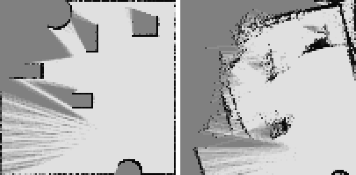

# Mapping: what does the robot see?

[Estimation](estimation.md) assumed the map was given. A robot in a new room has to build one. The simplest map a robot
can use is an *occupancy grid*: the room cut into square cells, each holding the robot's belief that something solid is
there. This page builds one when the robot's poses are known; [SLAM](slam.md) removes that assumption.

`rl_navigation.mapping` builds a log-odds occupancy grid from range scans at known poses (Thrun, Burgard and Fox,
*Probabilistic Robotics*, Table 9.1). It is the first step of the roadmap's occupancy-grid mapping and SLAM item (see
[docs/roadmap.md](../../roadmap.md)); SLAM, which needs no known poses, came in later pull requests (CHANGELOG.md,
2026-11-10). Like `rl_navigation.estimation` it imports only NumPy and `rl_navigation.sim`, so it runs on the robot.

```python
from rl_navigation.mapping import LIDAR_LOG_ODDS, OccupancyGrid
from rl_navigation.sim import lidar

grid = OccupancyGrid(lidar(), shape=(100, 100), resolution=0.05, model=LIDAR_LOG_ODDS)  # 5 x 5 m
grid.update(pose, readings)  # one scan at a known pose (x, y, theta)
occupied = grid.occupied()  # (rows, cols) booleans: more likely occupied than not
```

## Log-odds, beam by beam

Each cell holds the log-odds of being occupied, `log(p / (1 - p))`, so that a new reading is added to it rather than
multiplied, and a cell that was never seen is 0 (even odds, "unknown"). A beam says two things: the cells it passed
through are probably free, and the cell where it ended is probably occupied. Each beam's cells are traced exactly
(`rl_navigation.mapping.beams.traverse_cells`, half-open intervals, so a hit on a cell border goes to the far cell): the
endpoint's cell is marked occupied and the cells before it free, with log-odds clamped to [0.12, 0.97] (CHANGELOG.md,
2026-11-09). Clamping keeps a cell from becoming so sure that it could never change its mind. Readings at maximum range,
dropouts and NaN change nothing, because they say nothing about where a surface is
(`rl_navigation.sim.usable_readings` decides which readings count).

The sensor sets the model. The lidar preset gives a hit probability `p_hit` of 0.7 and a miss probability `p_miss` of
0.45, which makes a cell occupied after one hit and frees it again after 18 misses; the HC-SR04 preset uses 0.6 and 0.45
and traces each of its five cone rays with the mount's single reading. The grid has 5 cm cells by default (CHANGELOG.md,
2026-11-09).



Mapping with known poses: `rl_navigation.mapping.evaluation.build_map` on the lidar scans of one run of
`rl_navigation.estimation.runs.record_run` with seed 101 and 600 steps, the first run that `MAP-1` scores (TESTING.md
`MAP-1`). Dark cells are occupied, light ones free, grey unknown. Mapped from the encoders' dead reckoning instead, the
same scans smear the walls into the free space. The pose is as important as the sensor: a map is only as good as the
poses its scans were taken from.

## How good is the map?

On fresh seeds 101 to 150 (TESTING.md `MAP-1`, 600 steps a run) the lidar map is 99.96 % accurate with occupied
precision 1.0000, recall of the surfaces its beams reached 0.94 to 0.95 and free-space coverage 0.98; the HC-SR04's is
99.1 % accurate with precision 0.87 to 0.88. Built from dead reckoning instead of the true poses, the lidar map falls to
precision 0.34, with hundreds of cells mapped free inside obstacles (CHANGELOG.md, 2026-11-09). That drop is the case
for SLAM: the robot has to estimate its pose and the map together. An update takes 1.3 ms on the Jetson (lidar, 100 ×
100 cells) (TESTING.md `MAP-2`). `rl_navigation.mapping.evaluation` drives and scores such runs; the package does not
import it.

The planner reads this grid: `rl_navigation.planning.from_occupied` inflates the occupied cells by the robot's radius
into the cells its centre may not enter (see [Planning and control](planning.md#the-configuration-space)).

Continue with [SLAM](slam.md).
