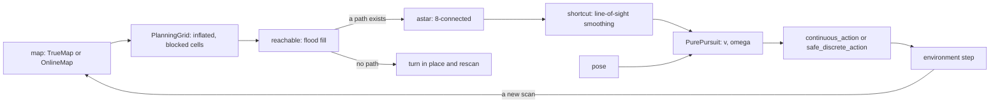

# Planning and control: from a map to motion

With a pose ([estimation](estimation.md)) and a map ([mapping](mapping.md)), the robot can decide where to drive. The
classical answer splits the work in two. A *planner* finds a collision-free path from the robot to the goal on the map;
a *controller* turns that path into the speed and turn rate the robot executes, step by step, and the planner runs again
when the map or the robot has moved away from the plan. A reinforcement learning agent, which the
[challenge page](../challenges/navigation.md) trains, does both in one network, from readings to action, with no map.
This page builds the classical pipeline and compares the two on the same layouts.

`rl_navigation.planning` is that pipeline: A* on the robot's configuration-space grid, path smoothing, a pure-pursuit
follower and a replanning navigator. It imports NumPy, `rl_navigation.sim` and `rl_navigation.mapping` only, so the
planner runs on the robot: a layer above the mapper, never importing the estimators, SLAM, the Gymnasium layer or a desk
tool (CHANGELOG.md, 2026-11-13).

## The configuration space

A disc robot of radius `r` collides with an obstacle when its centre comes within `r` of it. So the planner shrinks the
robot to a point and grows every obstacle by `r`: a cell is *blocked* when the robot's centre there would come within
the inflation `I` of an obstacle, and the planner uses `I = robot_radius + resolution / 2 + margin`. The half cell is
the conservative allowance of `rl_navigation.sim.layouts.path_exists`, and the margin is the safety the follower needs
(`rl_navigation.planning.PlanningGrid`). Two sources give the same type: the true map,
`rl_navigation.planning.from_arena` (exact for the arena's circles, boxes and walls), and a built map,
`rl_navigation.planning.from_occupied`, which takes the boolean grid of an `rl_navigation.mapping.OccupancyGrid` and
inflates by the true distance to each occupied cell's square (CHANGELOG.md, 2026-11-13).

## A*

`rl_navigation.planning.astar` is 8-connected A* with the octile distance as its heuristic: the exact cost on an empty
grid, so it is admissible and consistent and the path is optimal on the grid. A diagonal move is allowed only when both
orthogonal neighbours it passes are free, so the robot never squeezes between two diagonally blocked cells, and ties are
broken the same way every time, so a result is deterministic. Optimality is checked against exhaustive search and an
independent Bellman-Ford on 200 random grids (CHANGELOG.md, 2026-11-13).

Speed matters on a robot that replans. `rl_navigation.planning.reachable`, a flood fill, answers "no path" in about 8 ms
instead of a 70 ms failed search, so the navigator asks it first (CHANGELOG.md, 2026-11-13). On the held-out layouts of
the judged run, A* took a median of 1.2 ms and a 99th percentile of 15.75 ms (TESTING.md `PLAN-1`; CHANGELOG.md,
2026-11-19).

A grid path turns in steps of 45 degrees. `rl_navigation.planning.shortcut` pulls it tight: from each kept point it
jumps to the farthest later point whose straight segment crosses only free cells, so the result is an any-angle polyline
whose points are a subsequence of the input. Every point of such a segment keeps at least `I - resolution / sqrt(2)`
from every obstacle, so the inflation is what keeps the smoothed path off the walls (CHANGELOG.md, 2026-11-13).

## Following the path

`rl_navigation.planning.PurePursuit` (Coulter, CMU-RI-TR-92-01, 1992) steers at a target point on the path a *lookahead*
distance ahead. If the target lies at bearing `alpha` and distance `d`, the robot drives the arc of curvature
`2 sin(alpha) / d` at its top speed, and `omega` is that curvature times `v`; if `|omega|` would exceed its limit, both
are scaled down, which keeps the curvature. If `|alpha|` exceeds a turn-in-place threshold, the robot turns on the spot
instead. The robot's position is projected onto the path inside a short window of arc length, so progress never runs
backwards and cannot jump across a U-shaped path to a leg the robot is merely near (CHANGELOG.md, 2026-11-13).

The follower speaks the robot's own commands, `v` and `omega`, and the environment's actions encode them. For a
continuous action space `rl_navigation.planning.continuous_action` is the exact inverse of the environment's mapping;
for a discrete one `rl_navigation.planning.safe_discrete_action` picks the nearest of the five actions whose next 3
steps stay on free cells. These mappings stay planning functions, so the robot imports no Gymnasium environment (the
maintainer's decision) (CHANGELOG.md, 2026-11-13).

## The navigator

`rl_navigation.planning.Navigator` is the loop on the robot: plan on a map, follow the plan, replan when it goes stale.
Its map is a `rl_navigation.planning.TrueMap` (the arena itself, an oracle) or an `rl_navigation.planning.OnlineMap`, a
log-odds grid built only from the readings already in each observation. A plan is made like this:

1. **Margin ladder.** The map is inflated by the radius, half a cell and a margin `m` taken from `(margin, margin / 2,
   0)` in turn, and the first inflation that holds a path wins. The last rung is where the layout generator's guarantee
   of a path holds.
2. **Escape bubble.** If the robot's own cell is blocked, the cells blocked only by the inflation round it are freed for
   this search, so a robot caught inside the band can leave it; a cell holding an obstacle is never freed.
3. **Substitute goal.** If the goal's cell is blocked, the nearest free cell within 0.15 m of it (inside the
   environment's 0.2 m goal radius) is the target (CHANGELOG.md, 2026-11-13).
4. **Search.** The flood fill first, then A* only where it passes, then the shortcut, then a new follower.

It replans every `replan_every` steps, and earlier when the map has changed and the rest of the path crosses a blocked
cell. When no inflation level holds a path the status is `"no_path"` and the robot turns on the spot to rescan, in one
direction chosen when the status begins and held, since turning toward the goal's bearing at every step only dithers
about it (CHANGELOG.md, 2026-11-13). The margin and the turn-in-place threshold are tuned per action kind in
`rl_navigation.planning.TUNED_SETTINGS`: tuned on layouts 10000 to 10199, on the true map the navigator reached the goal
in 200 of 200 with either action kind, and on the online HC-SR04 map in 194 and 193 of 200 with no collision, the 13
timeouts stalling behind false walls in the sonar map (CHANGELOG.md, 2026-11-13).

**Why the sonar map wrote false walls.** An HC-SR04 reading is the nearest range over a 15° cone, so all five rays of
the cone mark a hit at that range, and the arc beside the real echo becomes wall. The online map gave every reading
beyond its 1 m map range to the grid as unusable, and an unusable reading clears nothing, so those walls stayed: most
readings in open space are farther than 1 m. Now a reading beyond the map range marks no hit but clears the cells its
rays cross before 1 m (`rl_navigation.mapping.grid.OccupancyGrid.update`'s `hit_range`, the split ROS's costmap makes
between obstacle and raytrace range), and on the same tuning layouts the online planner reached the goal in 198 and
198 of 200 (CHANGELOG.md, 2026-11-22). The cost shows under heavy range noise: a reading that comes back too long can
now clear a real wall too.

## Planner against trained policies

`rl_navigation.planning_comparison` plays a `rl_navigation.planning_comparison.PlannerController` (on the true map, or
on the online HC-SR04 map, with continuous and discrete actions at the tuned settings) and any
`rl_navigation.planning_comparison.Policy` on the same seeded layouts. It reports success with Wilson intervals,
collisions, timeouts, SPL (success weighted by path length: the shortest path over the longer of it and the path
driven), clearance and step times, and an exact McNemar test per checkpoint against each planner. It never imports
`rl_core`; the root `compare_planner.py` loads the configs and checkpoints and sweeps the same noise and dropout values
as the robustness benchmark (CHANGELOG.md, 2026-11-15; TESTING.md `PLAN-2` and `PLAN-3`).

The judged run played held-out layouts, once, with every gate registered beforehand. The report is
[planning_results.md](../../benchmarks/planning_results.md); read its rows rather than a summary of them. In short, and
as the maintainer's decision to publish it recorded (CHANGELOG.md, 2026-11-19): every registered gate passed. At nominal
sensors the online planner matches TD3 on two of its three seeds and beats the third, with shorter paths and no
collisions where the policies have a few. Under range noise the order reversed: the online map's false walls stalled
the planner while TD3 held its success rate. Dropout leaves the planners unhurt. That report's online rows predate the
false-wall fix. Judged again on fresh layouts after it, the online planner reached the goal on 99.8 and 99.6 % at
nominal sensors and on 94.8 and 95.2 % at range noise 0.4, as often as TD3 there, and collided about as often as TD3
(continuous) and less often than DQN (discrete) (CHANGELOG.md, 2026-11-22; TESTING.md `PLAN-4`).

What the comparison suggests (the author's reading, not a measured claim):

- The planner on the true map shows what a perfect map and pose allow; the online-map rows add the effect of building
  the map from sonar readings.
- A map can be wrong in a way a policy cannot: the online planner stalled on false walls its own map wrote, because the
  map threw away the far readings that would have cleared them; a policy reads the sensors each step and keeps no map
  to be wrong. The policies, in turn, collide at nominal sensors where the planner does not.
- The planner is a pipeline of parts that can each be tested and debugged on their own; the policy is one network, which
  is judged only by what it does.

**Known limits.** The comparison is open-ended work, listed in the "Planning follow-ups" item of
[docs/roadmap.md](../../roadmap.md): a gap can close on any cell map, since each occupied cell is inflated as a whole
square (one tuning layout of 200); every planner row uses the true pose, as the policies do, where the robot will have
the EKF's; the lidar rows are not played; and a bigger arena needs a faster search (CHANGELOG.md, 2026-11-19 and
2026-11-22, and the roadmap item).

Continue with [Export to the robot](export-to-robot.md), the last step of the track.
