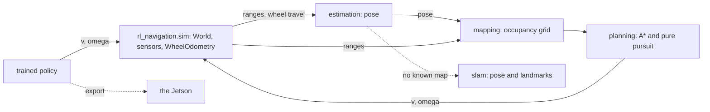

# The simulator and its sensors

The navigation track teaches the steps between "a robot with wheels and range sensors" and "a robot that drives itself
to a goal", in the order a robot does them: sense, estimate where it is, map what it sees, plan a path, act. This page
is the first step. It describes the simulated robot and the sensors and encoders whose noise every later step has to
live with. You come to it after the [Navigation-v0 challenge](../challenges/navigation.md), where a reinforcement
learning agent drives this robot from raw readings; the rest of the track builds the classical alternative, one
library module a page, and ends with how a trained policy reaches a real robot.



| Step | Page | Module |
| :--- | :--- | :--- |
| Sense | this page | `rl_navigation.sim` |
| Estimate the pose | [Estimation](estimation.md) | `rl_navigation.estimation` |
| Map | [Mapping](mapping.md) | `rl_navigation.mapping` |
| Estimate pose and map together | [SLAM](slam.md) | `rl_navigation.slam` |
| Plan and follow | [Planning and control](planning.md) | `rl_navigation.planning` |
| Reach the robot | [Export to the robot](export-to-robot.md) | `rl_core.export` |

## The simulator

`rl_navigation.sim` is a 2D robot simulator in pure NumPy. It imports neither Gymnasium nor `rl_core` (a subprocess
test holds that boundary), so the estimation, mapping and planning modules, and a real robot, can import it
(CHANGELOG.md, 2026-11-04). It holds an `rl_navigation.sim.Arena` of walls, circles and boxes; batched ray casting
(`rl_navigation.sim.cast_rays`); swept-disc collision; an occupancy grid; batched unicycle kinematics on the exact arc
(`rl_navigation.sim.kinematics.unicycle_step`); range sensors with an HC-SR04 and a lidar preset; a seeded layout
generator (`rl_navigation.sim.generate_layout`) that checks a path from start to goal exists; and a
`rl_navigation.sim.World` that steps the robot with wheel slip. One robot step with a sonar read runs at about 1,700 a
second on the Jetson's CPU (CHANGELOG.md, 2026-11-04).

The robot is a disc and a *unicycle*: a command is a forward speed `v` and a turn rate `omega`, and a differential-drive
base turns the two into a left and a right wheel speed. `World.step(v, omega, rng)` executes the command for one step
of `dt` seconds and returns a `rl_navigation.sim.Motion`: the command as the wheels actually did it, after slip, and
whether the move collided. A collision is a swept test along the step's chord, so a thin obstacle
is not skipped; a blocked move leaves the robot where it was, though the wheels turned.

**Wheel slip.** `World(wheel_slip=...)` is the largest fraction of a command lost to slip, in [0, 1]: each step scales
the forward speed and the turn rate by `1 - wheel_slip * u`, with `u` drawn uniformly from 0 to 1 for each of them. The
same command does not repeat exactly, and the pose after a step is not the pose the command promised. The navigation
environment can randomize the slip (and the sensor noise, the dropout and the obstacle count) over a range at every
reset, so an agent does not learn one robot's quirks (CHANGELOG.md, 2026-11-05; see [the challenge
page](../challenges/navigation.md#observation-action-and-reward)). Nothing in the simulator
tells the robot about slip. It shows up only as dead-reckoning drift, which is the reason [estimation](estimation.md)
exists.

## Range sensors

A sensor is a set of mounts at fixed angles to the robot's heading. Each mount reads the nearest surface inside its
cone, cast as `rays_per_cone` rays spread across the cone's full width (one ray for a lidar beam). The contract is the
same for the simulator and for a driver on the robot: a scan is an `(N,)` array of metres in mount order, within
`[min_range, max_range]`, reading exactly `max_range` when no echo returns. A hardware driver that replaces
`rl_navigation.sim.RangeSensor.read` must return the same.

**The HC-SR04** (`rl_navigation.sim.hc_sr04`) is the cheap ultrasonic sonar a hobby robot carries: five of them, facing
0, ±30 and ±60 degrees, on the perimeter of the 0.1 m robot, so readings are measured from its edge. The datasheet gives
a range of 2 cm to 4 m and a measuring angle of 15 degrees; the datasheet does not say whether that is the full or the
half angle, and the model takes the full cone, cast as 5 rays. The noise (0.01 m) and the dropout probability (0.02) are
not in the datasheet: they are placeholders until the real sensor is calibrated (CHANGELOG.md, 2026-11-04). Five
readings at 30 degrees apart see little of a room, and a 15 degree cone smears a thin object into a wide one.

**The lidar** (`rl_navigation.sim.lidar`) is a scanning range finder at the robot's centre: `num_beams` single-ray
beams over a full circle by default (64), 0.05 to 4 m, noise 0.01 m and no dropout unless asked. The figures are generic
placeholders, not those of a particular lidar (CHANGELOG.md, 2026-11-04). The robot will carry a 360° lidar at about 1°
per beam (the maintainer's decision, 2026-11-09), so the SLAM evaluation uses `lidar(num_beams=360)` (see
[SLAM](slam.md); CHANGELOG.md, 2026-11-10).

**Noise and dropout.** A reading carries Gaussian noise of standard deviation `noise_std`, and with probability
`dropout_prob` a reading is lost and reads `max_range`, as if nothing were there. `noise_std` and `dropout_prob` are
defaults: `RangeSensor.read` takes either as an argument, so an environment that randomizes them passes its own values
and the sensor stays the single source of truth. Every estimator and the mapper decide whether a reading carries a range
by one rule, `rl_navigation.sim.usable_readings`: `min_range < z < max_range`. A dropout, a driver's NaN, "nothing
within range" and a reading clipped at `min_range` are all unusable, and NaN is never usable (CHANGELOG.md, 2026-11-09).

```python
import numpy as np

from rl_navigation.sim import LayoutParams, World, generate_layout, hc_sr04

rng = np.random.default_rng(0)
layout = generate_layout(rng, LayoutParams())  # an arena, a start pose and a goal; a path is guaranteed
sensor = hc_sr04()
world = World(layout.arena, sensor, layout.start, layout.goal)
readings, _ = world.read_sensors(rng)  # 5 ranges in metres; max_range where there is no echo
motion = world.step(0.2, 0.0, rng)  # drive straight at 0.2 m/s for one step
```

## Odometry

A differential-drive robot counts the turns of each wheel. `rl_navigation.sim.WheelOdometry` models the encoders: a
reading is a `(2,)` array, the left and the right wheel's travel in metres since the previous reading, forward positive,
and each wheel's travel carries independent Gaussian noise whose variance grows with the distance it rolled, `k ×
|travel|` (Siegwart, Nourbakhsh and Scaramuzza, *Introduction to Autonomous Mobile Robots*, section 5.2.4). The wheel
base is 0.2 m and `k` is 2.5e-4 m; both are placeholders until the encoders are calibrated on the robot (the
maintainer's decision) (CHANGELOG.md, 2026-11-06). The same object is the motion model of the state estimators: the
noise they assume is the noise the simulator draws. Chaining the readings into a pose is *dead reckoning*, and its error
only grows, which the [estimation](estimation.md) and [mapping](mapping.md) pages measure.

Continue with [Estimation](estimation.md). The Gymnasium environments built on this simulator, with their actions,
observation and reward, are on [the challenge page](../challenges/navigation.md); how to install the libraries on a
robot is in [docs/navigation.md](../../navigation.md#installing-on-the-robot).
