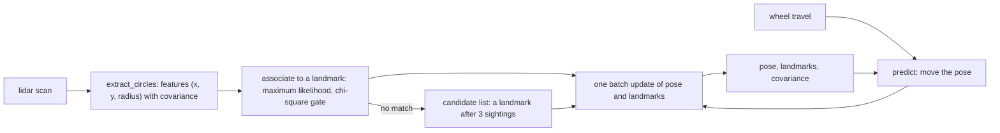
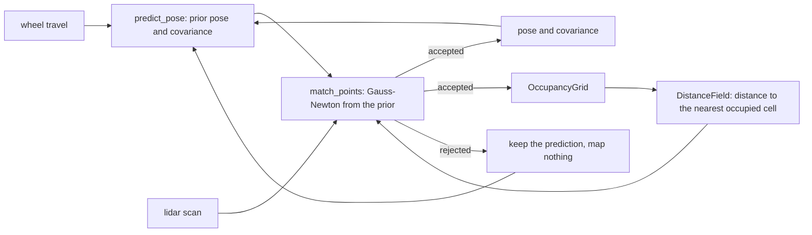

# SLAM: the pose and the map together

[Estimation](estimation.md) needed a map to find the pose, and [mapping](mapping.md) needed the poses to build the map.
*Simultaneous localization and mapping* (SLAM) does both at once, with neither given. This page builds the classical
landmark version: the robot picks landmarks out of its scans, keeps one Gaussian over its own pose and every landmark,
and corrects all of them each time it sees a landmark again.

`rl_navigation.slam` estimates the pose and a map of landmarks together, with no known map: landmark EKF-SLAM. Its
landmarks are the arena's cylinders, fitted as circles to a lidar's scan; the robot will carry a 360° lidar at about 1°
per beam (the maintainer's decision, 2026-11-09), so the evaluation uses `lidar(num_beams=360)` (CHANGELOG.md,
2026-11-10). Like `rl_navigation.estimation` it runs on the robot: it imports NumPy, `rl_navigation.sim` and the
`estimation` and `mapping` cores only. The second half of the page, [scan matching](#scan-matching), keeps the map as
an occupancy grid instead of landmarks.



## Circle features

```python
from rl_navigation.sim import lidar
from rl_navigation.slam import extract_circles

sensor = lidar(num_beams=360)
for feature in extract_circles(sensor, readings):  # one scan, metres
    x, y, radius = feature.z  # the centre in the robot's frame (x ahead) and the radius
    feature.covariance  # (3, 3), from the fit
```

A scan's usable readings are split where neighbouring points jump apart, and each segment of at least 8 points is fitted
with a circle. A segment bridges up to 3° of unusable beams (`FeatureSettings.max_bridged_angle`; dropouts, or no echo)
between two usable ones when their points pass the breakpoint scaled by the angle they span: 3 beams of the 1° lidar and
none of the 64-beam one, whose fits grow overconfident across a bridge; before that one dropped beam split every arc
(CHANGELOG.md, 2026-11-12). Each circle gets an algebraic start, then a geometric Gauss-Newton fit in which each
residual is weighted by the range noise projected on the surface (`σ·max(cos α, 0.3)`, α the beam's incidence), which
keeps the fit's covariance honest (mean NEES 2.8 to 2.9 on tuning seeds, 3.22 on seeds 101 to 150 and 2.93 with bridging
on seeds 151 to 200, against 3; TESTING.md `CIRC-1` and `CIRC-2`). A fit is kept when its residuals pass a χ² test, its
radius lies in 0.1 to 0.8 m, its centre lies beyond the points (a convex face), two straight lines do not explain the
points better (a box corner), and its result is sound (finite, a positive-definite covariance, no σ above 0.1 m);
nothing raises on a scan's content. The HC-SR04's five sonars, 30° apart, never give a feature: landmark SLAM needs the
lidar (CHANGELOG.md, 2026-11-10).

On fresh seeds 101 to 150 (TESTING.md `CIRC-1`, judged once on 2026-11-10) the 360-beam lidar finds 76 % of the circles
at least 8 beams reach, with a median centre error of 5.7 mm (p95 2.4 cm), a mean fit NEES of 3.22 and 0.05 % false
fits, in 6.4 ms a scan (p99 11 ms) on one Jetson core; every gate passes. Most missed circles touch a box, a wall or
another circle, so their points join one segment that no circle fits. A circle's fits from successive scans are not
independent: they share its viewing geometry, and the radius and the centre trade off on a short arc, so on tuning seeds
a circle's mean radius error sat up to a millimetre or two from zero (a per-circle probe on tuning seeds 1 to 5 while
the SLAM was planned; `radius_bias_t2` above 1 reflects this and the scans' serial correlation alike). Fusing hundreds
of them therefore needs a model-error floor in the filter (1.5σ, 15 mm on this lidar; below). The scoring lives in
`rl_navigation.slam.feature_evaluation`; the package does not import it (CHANGELOG.md, 2026-11-10).

## Landmark EKF-SLAM

```python
from rl_navigation.sim import WheelOdometry, lidar
from rl_navigation.slam import EkfSlam

slam = EkfSlam(lidar(num_beams=360), WheelOdometry(), start_pose, start_covariance)
slam.predict(wheel_travel)  # (left, right) metres, as EkfLocalizer.predict
result = slam.update(readings)  # extract circles, associate, one batch update, extend the map
slam.pose, slam.covariance  # the robot, as a Localizer
# (L, 3) circles (x, y, radius) and their (L, 3, 3) covariance blocks:
slam.landmarks, slam.landmark_covariances
```

`rl_navigation.slam.EkfSlam` is Thrun's EKF-SLAM (*Probabilistic Robotics*, Tables 10.1 and 10.2): one Gaussian over the
pose and every landmark `(x, y, radius)`, the wheel travel as the control, and the body-frame circle as the measurement,
with the fit's covariance plus a **model-error floor** of `floor_factor` × the range noise (1.5: 15 mm at 1 cm), which
absorbs the fit's per-circle bias; without it the radius grows overconfident as hundreds of fits are fused (the floor
brings its NEES to about 1 on tuning seeds) and a landmark's own features fall outside its gate and come back as
duplicates. A new feature is associated by maximum likelihood (a χ²₃ gate at 0.99, one to one per scan); one beyond
`new_landmark_nis` (30) from every landmark becomes a candidate, and a landmark after 3 sightings within 10 cm, in 3
scans (the provisional list); one in between is discarded (CHANGELOG.md, 2026-11-10).

**First-estimate Jacobians.** Its Jacobians are first-estimate Jacobians (FEJ, Huang, Mourikis and Roumeliotis 2008): a
plain EKF-SLAM linearizes at estimates that move between steps and so learns about the absolute heading, which nothing
measures (in a test, a robot starting at σθ = 0.3 rad and seeing two circles for 30 scans: standard Jacobians shrink σθ
to 0.02 rad, FEJ keeps 0.30); FEJ keeps the system's unobservable directions (global translation and rotation)
unobservable, which the tests check to 1e-12. There is no iteration and no hold, both of which would break that
(CHANGELOG.md, 2026-11-10).

**Re-acquisition and the heading term.** Every feature-landmark pair's noise also gets EKF2's second-order term
(`second_order_covariance`, on by default), computed with the unobservable frame taken out of the covariance: after a
long stretch without a circle in view σθ reaches about 0.3 rad, and one plain update linearised 0.4 to 0.5 rad from the
truth then collapsed σθ while leaving the pose far off (TESTING.md `SLAM-3`); while tracking the term is under 1.5 mm.
Past about 0.5 rad of heading error it limits the damage but no longer keeps the pose consistent (CHANGELOG.md,
2026-11-12).

The filter never raises on a scan's content: unsound features are skipped, labelled ones gated, and an update that
leaves the state non-finite, its covariance indefinite or the pose outside its bounds is undone
(`rl_navigation.slam.SlamUpdate` counts each) (CHANGELOG.md, 2026-11-10).

## How well does it work?

`rl_navigation.slam.evaluation` drives `run_trial`'s wanderer with the filter (`slam_trial`), optionally with an oracle
that labels each feature from the true pose (known correspondence), and scores it after aligning the estimated
trajectory to the true one (TESTING.md `SLAM-1`): SLAM cannot recover the start's error or the heading drift before its
first sighting, so its **aligned trajectory error** and the map's figures are the SLAM figures, and the absolute error
against dead reckoning is a low bar.

Judged once on fresh seeds 101 to 150 (`SLAM-1`, 2026-11-10), the 360-beam row passed 7 of its 9 gates: aligned error
6.4 cm mean and 1.1 cm median, 80 % of seen circles mapped, 0.24 spurious and 0.06 duplicate landmarks a run, 96 % of
steps under the NEES bound, 13 of 50 runs lost in absolute terms. It failed two: its absolute error was 0.44 of dead
reckoning's (gate 0.40), and 9 runs had an aligned error above 10 cm (gate 8). On tuning seeds 1 to 100 that association
gap did not reproduce (the oracle failed as often as maximum likelihood, 14 in 100 each) and the heading collapse above
was the main mechanism there; seeds 101 to 150 were not rerun. With the second-order term, judged once on fresh seeds
201 to 250 (`SLAM-3`, 2026-11-12), every gate passes: 0.30 of dead reckoning's error, 6 runs above 10 cm (3 of them in
layouts with at most one circle), one collapse, 3.9 cm mean aligned error and 89 % of seen circles mapped. An update
takes 8.6 ms (9.8 ms with 30 landmarks, 1.3 ms of it the second-order term) on one Jetson core (TESTING.md `SLAM-2`)
(CHANGELOG.md, 2026-11-10 and 2026-11-12).

**Known limits.** FEJ stays linearized at a landmark's first estimate, so a landmark first seen while the heading was
poorly known leaves the run wrong (the lost runs; OC-EKF is the follow-up); layouts with at most one circle barely beat
dead reckoning (box corners are the follow-up); and with 30 % of beams dropped the extraction finds 62 % of visible
circles, about 3 in 4 of those that keep 8 usable beams. Bridging up to 3° of dropped beams (TESTING.md `CIRC-2`, judged
on seeds 151 to 200, 2026-11-12) lifted it from 10 % with 28 % false fits (tuning seeds, before) and keeps false fits at
0.4 %, and the SLAM at 30 % dropout now fails 4 of 50 runs against 5 without dropout (CHANGELOG.md, 2026-11-12).

## Scan matching

Landmarks throw most of a scan away: only the beams that hit a cylinder count. *Scan matching* uses every beam. It keeps
the map as the log-odds grid of [mapping](mapping.md), built in the frame of the robot's first pose, and asks where the
robot must stand for the new scan's end points to land on the grid's occupied cells.



```python
from rl_navigation.sim import WheelOdometry, lidar
from rl_navigation.slam import ScanMatchingSlam

sensor = lidar(num_beams=360)
slam = ScanMatchingSlam(sensor, WheelOdometry(), start, covariance, (140, 140), (-1.0, -1.0))
slam.predict(wheel_travel)  # the encoders' (left, right) travel, metres
result = slam.update(readings)  # match the scan, then map it if the match was accepted
slam.pose, slam.covariance, slam.grid  # the grid is a mapping.OccupancyGrid
```

The grid becomes a field first: `rl_navigation.mapping.fields.distance_field` gives each cell the distance from its
centre to the nearest occupied cell's, and `DistanceField.sample` interpolates it between cell centres with its
gradient. This is the likelihood field of Thrun, Burgard and Fox's *Probabilistic Robotics*. `match_points` then
minimises, as Hector SLAM does (Kohlbrecher and colleagues), the squared distance of every end point from the map,
capped at `max_distance`, plus the distance of the pose from the odometry prediction in the prediction's own covariance.
A beam farther than the cap from every occupied cell is an outlier with a fixed cost, so a chair the map does not hold
cannot pull the pose. Each Gauss-Newton step uses the field's gradient, and a step that would raise the cost is halved.
The covariance of the result is the inverse of the cost's curvature there. A match is accepted when enough of its beams
fit the map closely and it did not move further from the prediction than a chi-square gate allows; then the scan is
mapped at the matched pose. A rejected scan keeps the prediction and leaves the map alone.

**How well does it work?** On a map built from the true poses, the matcher alone lands within 8.4 mm of the true pose
in the median, 1.7 cm at the 95th percentile, from priors 3 cm and 0.03 rad off, and its covariance is consistent (mean
NEES 3.01, where 3 is consistent; TESTING.md `SCAN-1`). As a SLAM front end with the 360-beam lidar, judged once on
fresh seeds 251 to 300, its aligned trajectory error is 1.0 cm mean, against 36 cm for dead reckoning over the same
encoders, with no run above 10 cm, maps whose occupied cells are 99.97 % right, and 0.9 cm at 30 % dropout
(TESTING.md `SLAM-4`). An update (field, match and mapping) takes 9.5 to 9.7 ms in the median on one Jetson core
(TESTING.md `SLAM-5`) (CHANGELOG.md, 2026-11-22).

**Known limits.** The front end has no loop closure and no map uncertainty: its covariance is the pose's relative to a
map that drifts unseen, so it is overconfident against the truth (aligned NEES 168 where 3 is consistent). A surface on
a cell border is mapped half a cell (2.5 cm) behind itself, the same way along the whole surface, which is why each end
point's noise is set to 3.3 cm against the lidar's 1 cm. With the 64-beam lidar, in some runs the first map, one sparse
scan, cannot explain the next scans: every later match is rejected and the map never grows. At least one of the 50
judged runs locked out and 4 failed, not all of them by locking out (the `warmup_scans` follow-up in the roadmap)
(CHANGELOG.md, 2026-11-22).

Continue with [Planning and control](planning.md), which turns a map and a pose into motion.
